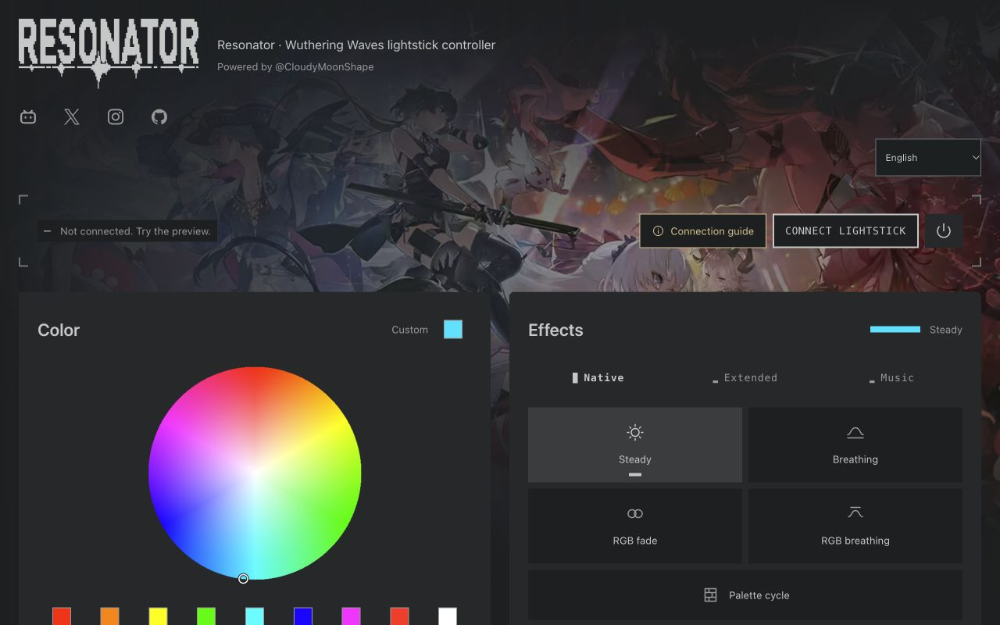
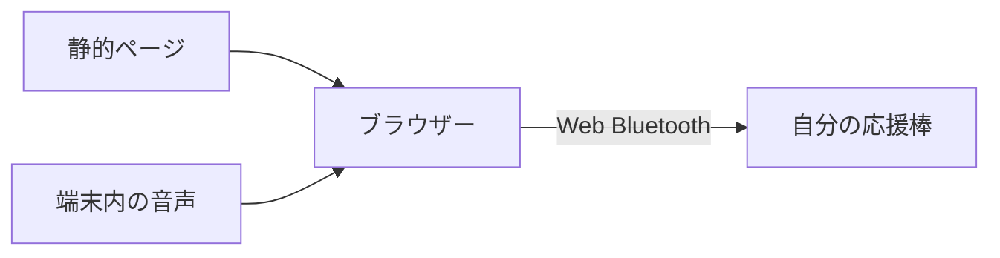

<picture>
  <source media="(prefers-color-scheme: dark)" srcset="docs/assets/resonator-dark.svg">
  <source media="(prefers-color-scheme: light)" srcset="docs/assets/resonator-light.svg">
  
</picture>

Resonator はブラウザーから『鳴潮』コンサートの応援棒を操作します。

**[コントローラーを開く](https://wuwa.south-wall.com/?lang=ja)** · [ドキュメント](docs/ja/README.md) · [English](README.md) · [简体中文](README.zh-CN.md)

[](https://wuwa.south-wall.com/?lang=ja)

色を選び、エフェクトを再生し、音楽に合わせて光らせます。アカウントの作成やファームウェアの変更は不要です。

| 本体エフェクト | 拡張エフェクト | 音楽 |
|---|---|---|
| 応援棒の内部タイマーで動作します。 | ブラウザーが独自の色の変化を送信します。 | ファイル、共有タブの音声、またはマイク入力を解析します。 |
| 滑らかな明滅、RGB グラデーション、プリセットの切り替え。 | 速度を変えられる明滅、鼓動、ろうそく、独自の配色。 | 音声解析は使用中の端末で行います。 |

## 接続

1. Android、macOS、Windows の Chrome、または macOS、Windows の Edge でコントローラーを開きます。
2. **応援棒を接続**を選びます。
3. 自分の機器 `JFKJ-FBFB` を選びます。
4. 青い光が 3 回点滅するまで待ちます。その後、色やエフェクトを選びます。

サイトは中国語、英語、日本語に対応します。通常はブラウザーの言語を使います。言語メニューで変更できます。[使い方](docs/ja/QUICKSTART.md)を参照してください。

iPhone と iPad の Safari、Chrome にはネイティブ Web Bluetooth インターフェースがなく、画面プレビューのみ利用できます。接続ガイドには、Bluefy や beacio Safari 拡張機能などの任意の橋渡し手段を記載しています。これらはインストールが必要で、ブラウザーのネイティブ対応とは異なります。接続ガイドで機器別の手順を確認してください。[ブラウザー対応（英語）](docs/SDK.md)を参照してください。

研究用サンプルの基板は `HE-750G24`、ファームウェアは `V4.1.8` です。別の基板やファームウェアでは動作が異なる場合があります。点滅エフェクトは個別に有効にする必要があります。

## 仕組み



ページは Cloudflare Pages から読み込みます。その後、制御コマンドはブラウザーから応援棒へ直接送信します。任意の訪問カウンターは別のサービスを使います。制御機能はそのサービスに依存しません。

JavaScript SDK は独自に実装したホスト側のコードです。メーカーのファームウェアや SDK コードは含みません。

以下の技術資料は英語です。中国語版へのリンクは各資料にあります。

| 開発・調査 | 資料 |
|---|---|
| 接続とコマンド送信 | [SDK](docs/SDK.md) |
| 本体のエフェクト | [Native effects](docs/NATIVE-EFFECTS.md) |
| 色と明るさ | [Color mixing](docs/COLOR-MIXING.md) · [Dimming](docs/DIMMING.md) |
| ハードウェアとプロトコル | [Hardware](docs/HARDWARE.md) · [Protocol](docs/PROTOCOL.md) |
| ファームウェア調査 | [Function map](docs/FUNCTIONS.md) · [Analysis tools](re/README.md) |

## ローカルで実行

Node.js 24 と Python 3 を使います。コントローラーのビルドに npm パッケージのインストールは不要です。

```sh
npm test
npm run build
python3 -m http.server 8765 -d dist
```

[localhost:8765](http://localhost:8765/?lang=ja) を開きます。ビルドで共通ヘッダーとフッターを挿入するため、サーバーを起動する前にビルドしてください。Web Bluetooth には HTTPS または localhost が必要です。

独立した SDK のサンプルを使う場合は、リポジトリのルートを配信し、`/sdk/examples/color.html` を開きます。Pages と任意の訪問データベースについては、[Deployment（英語）](docs/DEPLOYMENT.md)を参照してください。

## 確認範囲

研究用サンプルでは、接続、原色、一部の混色、本体の単色明滅について実機記録があります。ユーザーは本体の明滅が滑らかであると報告しました。色の調整は目視によるもので、測定器による校正ではありません。

自動テストはフレーム、通信処理、混色、調光、訪問カウントを確認します。光学的なタイミングや他の機器との互換性を証明するものではありません。会場放送の動作はファームウェアの静的解析に基づき、無線での実測は行っていません。[Verification（英語）](docs/VERIFICATION.md)を参照してください。

## ライセンス

無償での使用、変更、共有、ホスティングを認めます。別途書面による許可がない限り、ソフトウェアの販売、有料アクセス、有料ホスティング、有料商品への同梱は禁止します。

[Community License](LICENSE) はソース公開型のライセンスです。OSI 承認のオープンソースライセンスではありません。正式な条件は英語のライセンス本文です。[第三者の素材（英語）](THIRD_PARTY.md)には別の権利が適用されます。

[開発への参加（英語）](CONTRIBUTING.md) · [セキュリティ問題の報告（英語）](SECURITY.md)
