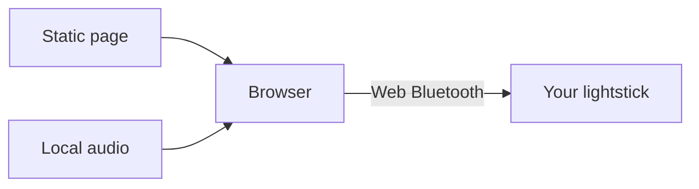

<picture>
  <source media="(prefers-color-scheme: dark)" srcset="docs/assets/resonator-dark.svg">
  <source media="(prefers-color-scheme: light)" srcset="docs/assets/resonator-light.svg">
  
</picture>

Control your Wuthering Waves concert lightstick from a browser.

**[Open controller](https://wuwa.south-wall.com/)** · [Documentation](docs/README.md) · [简体中文](README.zh-CN.md)

[](https://wuwa.south-wall.com/)

Choose a color. Play an effect. Make the light follow your music. No account or firmware change is required.

| Native effects | Extended effects | Music |
|---|---|---|
| The lightstick runs its own timers. | The browser sends custom color sequences. | The browser analyzes a file, shared tab audio, or microphone input. |
| Smooth breathing, RGB fades, and preset cycles. | Adjustable breathing, heartbeat, candlelight, and custom palettes. | Audio analysis stays on your device. |

## Connect

1. Open the controller in Chrome on Android, macOS, or Windows, or Edge on Windows or macOS.
2. Select **连接应援棒** (Connect lightstick).
3. Select your device, named `JFKJ-FBFB`.
4. Wait for the three blue flashes. Then choose a color or effect.

The website interface is in Chinese. Safari and Chrome on iPhone or iPad do not provide Web Bluetooth and support screen previews only. To connect from an iPhone, use a free Web Bluetooth browser app such as Bluefy, or the beacio Safari extension; the controller's “连接说明” dialog gives step-by-step Chinese instructions per device. See [browser support](docs/SDK.md).

The research sample has board `HE-750G24` and firmware `V4.1.8`. Other hardware or firmware versions can behave differently. Flashing effects require a separate opt-in.

## How it works



The page loads from Cloudflare Pages. After it loads, control commands go directly from your browser to the lightstick. An optional visitor counter uses a separate service. Control does not depend on that service.

The JavaScript SDK is an independent host implementation. It does not contain manufacturer firmware or vendor SDK code.

| Build or study | Read |
|---|---|
| Connect and send commands | [SDK](docs/SDK.md) |
| Use firmware effects | [Native effects](docs/NATIVE-EFFECTS.md) |
| Understand color and brightness | [Color mixing](docs/COLOR-MIXING.md) · [Dimming](docs/DIMMING.md) |
| Inspect the hardware and protocol | [Hardware](docs/HARDWARE.md) · [Protocol](docs/PROTOCOL.md) |
| Continue firmware research | [Function map](docs/FUNCTIONS.md) · [Analysis tools](re/README.md) |

## Run locally

Use Node.js 24 and Python 3. No npm packages are required for the controller build.

```sh
npm test
npm run build
python3 -m http.server 8765 -d dist
```

Open [localhost:8765](http://localhost:8765). Build before you serve the page: the build inserts the shared header and footer. Web Bluetooth requires HTTPS or localhost.

For the separate SDK examples, serve the repository root and open `/sdk/examples/color.html`. See [deployment](docs/DEPLOYMENT.md) for Pages and the optional visitor database.

## Evidence

The research sample has hardware records for connection, primary colors, selected mixed colors, and native single-color breathing. The user reported smooth native breathing. Color tuning is based on visual observation, not instrument measurements.

Automated tests check frames, transport behavior, color mapping, dimming, and visitor counting. They do not prove optical timing or compatibility with other devices. Venue broadcast behavior comes from static firmware analysis and has not been tested over radio. See [verification](docs/VERIFICATION.md).

## License

Free use, modification, sharing, and free hosting are permitted. Software sales, paid access, paid hosting, and paid bundles are prohibited without separate written permission.

The [Community License](LICENSE) is source-available. It is not an OSI-approved open-source license. [Third-party materials](THIRD_PARTY.md) retain separate rights.

[Contribute](CONTRIBUTING.md) · [Report a security issue](SECURITY.md)
