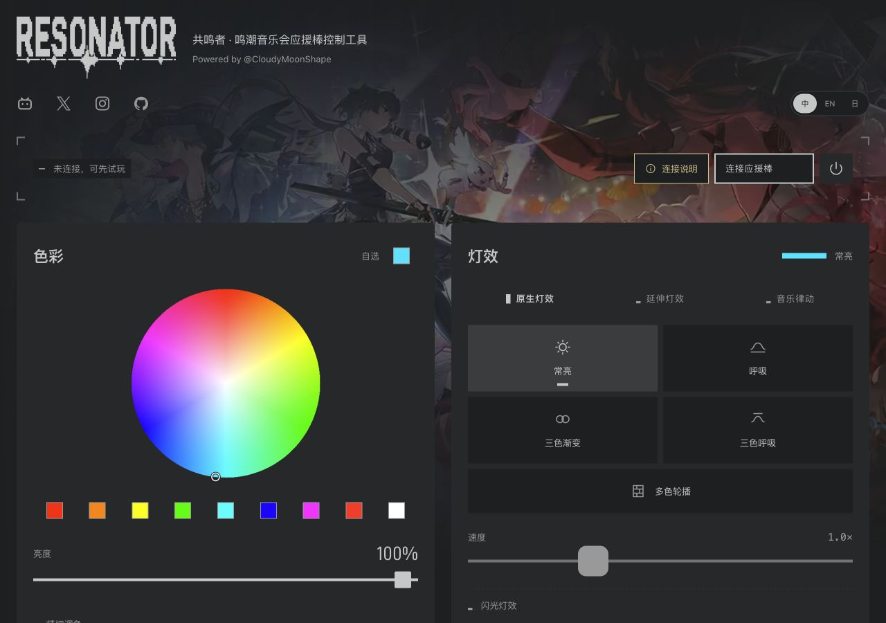
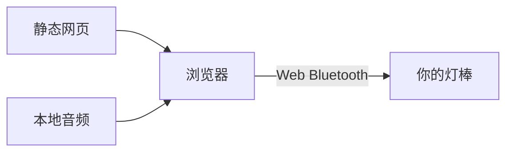

<picture>
  <source media="(prefers-color-scheme: dark)" srcset="docs/assets/resonator-dark.svg">
  <source media="(prefers-color-scheme: light)" srcset="docs/assets/resonator-light.svg">
  
</picture>

共鸣者：在浏览器中控制你的鸣潮音乐会应援棒。

**[打开控制台](https://wuwa.south-wall.com/?lang=zh)** · [开发文档](docs/zh-CN/README.md) · [English](README.md) · [日本語](README.ja.md)

[](https://wuwa.south-wall.com/?lang=zh)

选颜色，播放灯效，让灯光跟随音乐。无需账号，也无需更换固件。

| 原生灯效 | 延伸灯效 | 音乐 |
|---|---|---|
| 由灯棒内部计时器运行。 | 由浏览器发送自制颜色序列。 | 浏览器分析文件、共享标签页声音或麦克风输入。 |
| 平滑呼吸、三色渐变与预设轮播。 | 调速呼吸、心跳、烛光与自制配色。 | 音频分析在本机完成。 |

[手机版](docs/screenshots/controller-mobile-zh.png) · [原理页](docs/screenshots/principles-desktop-zh.png)

## 连接

1. 在 Android、macOS 或 Windows 上使用 Chrome，或在 Windows、macOS 上使用 Edge，打开控制台。
2. 点击“连接应援棒”。
3. 选择自己的 `JFKJ-FBFB` 设备。
4. 等待三次蓝灯闪烁结束，再选择颜色或灯效。

网站支持中文、英文和日文，默认采用浏览器语言，也可手动切换。见[语言选择](docs/zh-CN/LOCALIZATION.md)。

iPhone 和 iPad 上的 Safari、Chrome 没有原生 Web Bluetooth，只支持屏幕预览。使用 Bluefy 浏览器连接，需要先安装，不属于 Safari 或 Chrome 的原生支持。请打开连接说明查看对应设备的步骤。见[浏览器支持](docs/zh-CN/SDK.md)。

研究样机采用 `HE-750G24` 主板和 `V4.1.8` 固件。其他硬件或固件版本可能有不同行为。闪光效果需要单独开启。

## 原理



网页从 Cloudflare Pages 加载。加载后，控制指令由浏览器直接发给灯棒。可选的到访计数使用独立服务，控制功能不依赖它。

JavaScript SDK 是独立编写的主机侧实现，不包含厂家固件或厂商 SDK 代码。

| 开发或研究 | 文档 |
|---|---|
| 连接与发送指令 | [SDK](docs/zh-CN/SDK.md) |
| 使用固件内置灯效 | [原生灯效](docs/zh-CN/NATIVE-EFFECTS.md) |
| 理解颜色与亮度 | [混色](docs/zh-CN/COLOR-MIXING.md) · [调光](docs/zh-CN/DIMMING.md) |
| 查看硬件与协议 | [硬件](docs/zh-CN/HARDWARE.md) · [协议](docs/zh-CN/PROTOCOL.md) |
| 继续固件研究 | [函数地图](docs/zh-CN/FUNCTIONS.md) · [分析工具](re/README.zh-CN.md) |

## 本地运行

使用 Node.js 24 和 Python 3。控制台构建不需要安装 npm 包。

```sh
npm test
npm run build
python3 -m http.server 8765 -d dist
```

打开 [localhost:8765](http://localhost:8765)。先构建，再启动静态服务；构建会插入共用页头和页脚。Web Bluetooth 需要 HTTPS 或 localhost。

单独运行 SDK 示例时，从仓库根目录启动静态服务，然后打开 `/sdk/examples/color.html`。Pages 和可选到访数据库的配置见[部署](docs/zh-CN/DEPLOYMENT.md)。

## 证据

研究样机已有连接、三原色、部分混色和原生单色呼吸的实物记录。用户确认原生呼吸平滑。颜色调整依据肉眼观察，不是仪器测量。

自动测试检查指令帧、传输行为、混色、调光和到访计数，不证明光学时序或其他设备的兼容性。现场广播行为来自固件静态分析，尚未做无线实测。见[验证记录](docs/zh-CN/VERIFICATION.md)。

## 许可

允许免费使用、修改、分享和免费托管。未经另行书面授权，禁止销售软件、付费访问、付费托管和付费捆绑。

[社区许可证](LICENSE)是源码可用许可，不是 OSI 认可的开源许可证。[第三方材料](THIRD_PARTY.zh-CN.md)保留独立权利。

[参与开发](CONTRIBUTING.zh-CN.md) · [报告安全问题](SECURITY.zh-CN.md)

[iPhone 图文连接教学](docs/zh-CN/IOS.md)
