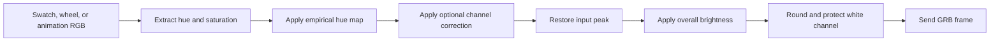

# Color mixing

[中文](zh-CN/COLOR-MIXING.md) · [Documentation](README.md)

The browser uses an empirical hue map. The sample operator accepted the result by eye. It is not a colorimetric calibration.

Raw red, green, and blue looked correct. Pink `[255,32,32]` was also accepted. Orange and yellow from the earlier browser palette looked green. The available JPEG images had clipped highlights, so they could not establish channel output ratios. These observations do not prove a firmware defect.

## Color path

`web/color.js` contains the pure functions. The SDK does not apply this map. It sends the raw RGB values supplied by the caller.

| Hue | Full-saturation output |
|---:|---|
| 0° | `[255,0,0]` |
| 30° | `[255,32,0]` |
| 60° | `[255,96,0]` |
| 120° | `[0,255,0]` |
| 180° | `[0,255,255]` |
| 240° | `[0,0,255]` |
| 300° | `[255,0,255]` |
| 360° | `[255,0,0]` |

The yellow green component can be set from 16 to 255. The default is 96. The orange green component is `min(32, yellowGreen / 2)`.

The function interpolates between adjacent hue points, then normalizes the largest channel. It retains the input saturation and value. Optional channel gains apply only to non-neutral colors. After the gains, the function restores the input peak. Preserving the peak does not preserve perceived brightness or luminous flux.

`web/dimming.js` supplies one overall brightness factor. It does not apply separate gamma curves to R, G, and B. See [Dimming](DIMMING.md).

## White-channel handling

The firmware selects W when `R = G = B > 0`. All-zero RGB switches the light off.

The browser uses equal values for intended white and gray. If rounding makes a non-neutral color equal and nonzero, the map subtracts one unit from the channel with the lowest input value. This prevents an unintended switch to W. Small color shifts can still occur at low brightness because each channel has only 256 values.

The map does not attempt simultaneous, independent RGBW control. The browser does not offer a raw-color mode. Use the SDK or CLI for raw protocol work.

## Design references

The implementation uses general LED color-space ideas. It does not copy code from these projects or add their libraries:

- [FastLED HSV colors](https://github.com/FastLED/FastLED/wiki/FastLED-HSV-Colors): a rainbow hue map differs from a conventional HSV spectrum.
- [WLED settings](https://kno.wled.ge/features/settings/): color gamma, brightness gamma, and white-channel policy are separate controls.
- [Adafruit LED gamma](https://learn.adafruit.com/led-tricks-gamma-correction/the-longer-fix): an empirical gamma value is not a measurement of every device.

A gamma curve alone cannot change the ratio of two channels that are both at their maximum. Thus it cannot correct `[255,255,0]` if that mix looks green. Different hardware still needs its own measurements.

## Verification

The color-map audit checked accepted colors, yellow adjustment, independent brightness, white-channel protection, and a full hue scan. Browser checks covered wheel input, zero saturation, the yellow output `[255,96,0]`, and console errors. The operator reported a large improvement on the sample.

The historical audit passed 15 tests: 11 SDK tests and four color-map tests. Run the current suite for the current count. Canvas draws the wheel locally. Use `npm run build` to measure the current page size.
