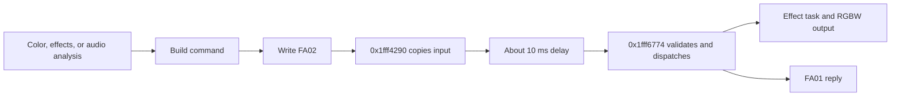

# Functions and evidence

[简体中文](zh-CN/FUNCTIONS.md)

This reference describes one research sample. Function names describe observed behavior; they are not manufacturer symbols. Addresses come from static analysis and can change with firmware. A hardware observation is not the same evidence as a simulated test.

## Control path

The [principles page](https://wuwa.south-wall.com/principles) explains the hardware and browser control path.

## Firmware addresses

| Address | Description | Evidence and limits |
|---|---|---|
| `0x1fff4290` | FA02 write callback. Copy input to `0x1fffc343`; schedule processing about 10 ms later. | Static analysis; no hardware trace of this address. |
| `0x1fff6774` | Compare the handshake, validate the checksum, and dispatch GATT commands. | Static analysis. Separate device tests cover the handshake and `01`. |
| `0x1fff2fd4` | Raw RF event handler, OSAL task 10. | Static analysis; no RF test. |
| `0x1fff73c0` | Filter AdvA; pass raw RF payloads to `0x1fff6b14`. | Static analysis; no RF test. |
| `0x1fff6b14` | Decode venue payloads and dispatch by type. | Static analysis; no RF test. |
| `0x1fff7c60` | Light-effect task, OSAL task 11. | Static analysis; not proof of every effect parameter. |
| `0x1fffc1cc` | RF configuration data. `+0x20`: format/whitening/CRC; `+0x24`: CRC initial value; `+0x28`: Access Address; `+0x40`: frequency. | Static analysis. This is data, not a function. |
| `0x1fff8834` | 64-byte XOR table. | Static analysis; constants are in `scripts/venue_packet.py`. |
| `0x1fffc343` | GATT input buffer. | Static analysis; input-size and overflow behavior are not established. |
| Flash `0x3c000` | Device group number. | Reference value 2. Type 6 can persistently change it; no transmission test. |
| Flash `0x3000` | Application partition table. | Read by the reconstruction script. Flash base `0x11000000`; application storage offset `0x11000`. |
| Flash `0x30100` | Word with inconsistent repeated reads on the sample. | Observed during reads. Cause unknown; do not generalize to the model. |

## GATT commands

`cc` is the negative sum of the preceding bytes, modulo 256. `HI LO` is a big-endian 16-bit interval in milliseconds.

| Input | Meaning | Evidence and limits |
|---|---|---|
| ASCII `JFKJ-20250421` | Write to FA02 within 8 seconds. Stop the disconnect timer, echo through FA01, and flash blue three times. | Historical device tests. Animation about 0.9 s; CLI waits 1.5 s, SDK waits 1.2 s. |
| `01 xx G R B cc` | Set color. The analyzed branch does not use `xx`; use zero. | GRB order, red/green output, and retention after disconnect were observed. |
| `02 00 G R B cc` | Native single-color breathing; about 2.6 s per cycle. | Static and simulated tests. The owner confirmed smooth output on the sample. |
| `03 00 cc` | Three-color fade; event interval about 4 ms. | Static and simulated tests; individual device test pending. Not a reset. |
| `04 00 G R B HI LO cc` | Single-color on/off effect. | Static and simulated tests; individual device test pending. Interval 1–65534 ms. |
| `05 00 HI LO cc` | RGB steps, with firmware colors and brightness. | Static and simulated tests; individual device test pending. Interval 1–65534 ms. |
| `06 00 cc` | RGB breathing with a fixed cycle. | Static and simulated tests; individual device test pending. |
| `07 00 f9` | Five flashes per RGB color; 95 ms on/off phases. | SDK wrapper, static and simulated tests; individual device test pending. |
| `08 00 f8` | Cycle through 15 colors, about 580 ms per color. | SDK wrapper, static and simulated tests; individual device test pending. |
| `09`–`0c` | Combined, seven-color, white, and red/blue patterns. | Research only; no SDK device-call wrappers. |
| `0d 00 00 00 00 cc` | Stop internal effects and turn the light off. | Static trace. Wait for the matching `AD` reply before changing modes. |
| `0e 00 G R B cc` | Continuous color without repeated clearing. | Static trace. Equal, nonzero RGB selects full white; the SDK avoids that case. |

See [native effects](NATIVE-EFFECTS.md) for timers, button modes, state fields, and branch evidence.

For `01`, equal nonzero channels select white; all zero turns the light off. In modes 2 and 4, a color reply can start with `a1` and the color becomes the effect base color. FA01 shows protocol processing, not measured optical output. Neither the plaintext handshake nor the checksum proves ownership or provides secure authentication.

## Project functions

| Function | Input → output | Use and limits |
|---|---|---|
| `scripts/stick_ble.py::frame(body)` | Bytes → frame with negative-sum checksum | Pure conversion. Python `bytes` checks the value range. |
| `scripts/stick_ble.py::parse(argv)` | `color R G B` or `raw HEX…` → frame | Convert RGB to GRB. `raw` is a research interface; it does not check effect safety. |
| `scripts/stick_ble.py::main(cmd)` | Encoded frame → Bluetooth write | Find the device name, subscribe to FA01, send the handshake, wait 1.5 s, then write. Do not select blindly when several devices have the same name. |
| `scripts/venue_packet.py::payload(cmd, group, *args)` | `color` or `preset`, group 1–20 → plaintext body | Types 1 and 4 only. Zero placeholders for lower groups are not an ignore mask. |
| `scripts/venue_packet.py::scramble(body, key)` | Body → checksum and XOR payload | `key & 0x3f` selects the table entry. This is obfuscation, not cryptographic encryption. |
| `scripts/venue_packet.py::pdu(body, key)` | Body → header, six-byte AdvA, payload | Construct bytes only. No RF generation, transmission, or radio-generated CRC. |
| `scripts/phy_read.py::connect_patient(phy, baud)` | Serial object and baud rate → connection initialization | Retry for up to 600 s. Omit `FlashUnlock`. Initialize serial/peripheral registers; no flash write. |

Use the [SDK](SDK.md) for the supported development interface and examples. See [protocol research](PROTOCOL.md) for RF parameters and reference hashes.

## Add evidence

Test connection, reconnection, channel behavior, and audio/light timing on a real device. Record the board, firmware version and hash, input frame, reply, visible result, steps, and date.

Analyze unknown parameters and side effects before testing an isolated device that you own. Do not use OTA writes or venue broadcasts as a trial-and-error method.
