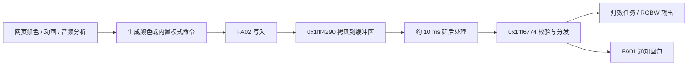

# 函数、字段与证据目录

这是一份针对研究样机的兼容性说明，不是厂家 SDK。这里的函数名是研究者按行为给出的描述，**不是厂家原始符号**。地址来自历史静态分析；换固件版本后可能全部变化。硬件历史实测与本轮软件检查分开记录。

## 控制数据流

[交互式字节实验台](https://wuwa.south-wall.com/principles) 可以不连接设备，查看每个通道和校验值。

## 固件入口与数据

| 地址 | 研究描述 | 来源与可信边界 |
|---|---|---|
| `0x1fff4290` | FA02 写回调，拷贝输入至 `0x1fffc343`，约 10 ms 后处理 | 静态逆向；地址本身未用硬件跟踪验证 |
| `0x1fff6774` | 口令比对、校验和验证、按首字节分发 GATT 命令 | 静态逆向；口令与 `01` 颜色行为另有历史实测 |
| `0x1fff2fd4` | 原始射频任务的事件处理入口，OSAL 任务 10 | 静态逆向，未实测射频 |
| `0x1fff73c0` | 原始射频收包，过滤 AdvA 后交给 `0x1fff6b14` | 静态逆向，未实测射频 |
| `0x1fff6b14` | 现场广播载荷解码与类型分发 | 静态逆向，未实测射频 |
| `0x1fff7c60` | 灯效任务，OSAL 任务 11 | 静态逆向；不能据此声称已知所有灯效参数 |
| `0x1fffc1cc` | 射频配置结构 | 静态逆向；`+0x20` 包格式/白化/CRC、`+0x24` CRC 初值、`+0x28` Access Address、`+0x40` 频率 |
| `0x1fff8834` | 64 字节 XOR 表 | 静态逆向；可在 `scripts/venue_packet.py` 看到完整常量 |
| `0x1fffc343` | GATT 输入缓冲区 | 静态逆向；不提供未确认的长度或越界行为结论 |
| flash `0x3c000` | 设备分组号 | 历史备份为 2；广播类型 6 可持久改写，未实测发送 |
| flash `0x3000` | 应用分区表 | 重建脚本读取入口；映射基址 `0x11000000`，应用存储偏移 `0x11000` |
| flash `0x30100` | 历史样机重复读取不稳定的一个字 | 多次读取观察；原因未确认，不能视为型号通病 |

## GATT 命令目录

| 输入 | 当前可解释的含义 | 验证状态 |
|---|---|---|
| ASCII `JFKJ-20250421` | 连接后 8 秒内写 FA02；成功停止断连计时，FA01 回显，闪三次蓝灯约 0.9 秒 | 历史硬件实测；Python CLI 等待 1.5 秒；网页 SDK 等待约 1.2 秒后再设色 |
| `01 xx G R B cc` | 设色；`xx` 固件未使用，`cc = -sum(前面字节) mod 256` | GRB 字节序、红绿设色与断连保持为历史实测 |
| `02 00 G R B cc` | 自选色内置呼吸，约 2.6 秒一轮 | 静态追踪；SDK / 模拟验证；待实物 |
| `03 00 cc` | 三色渐变，事件约 4 ms 更新 | 同上；不是复位 |
| `04 00 G R B HI LO cc` | 自选色亮灭，16 位毫秒间隔 | 同上；间隔 1–65534 |
| `05 00 HI LO cc` | 三色跳变，16 位毫秒间隔 | 同上；固件配色 / 亮度 |
| `06 00 cc` | 三色呼吸，固定周期 | 同上；固件配色 / 亮度 |
| `0d 00 00 00 00 cc` | 清灯并停止内部效果，用于退出 | 静态追踪；等待 AD 回包后再切换 |
| `0e 00 G R B cc` | 连续设色时跳过重复清灯 | 静态追踪；等值非零 RGB 会开满 W，必须绕开 |
| `07`–`0c` | 脉冲 / 预设 / 组合图案候选 | 保留研究记录，不提供设备调用封装 |

新增定时中断、按键模式、状态字段、逐命令布局及验证证据见 [内置能力](NATIVE-EFFECTS.md#函数状态与证据链)。

补充：`R=G=B>0` 时固件选择白光通道；全零为关灯。灯效模式 2/4 下设色回包首字节可为 `a1`，颜色存为灯效色。FA01 回包表示固件处理后的通知，不等于光学结果已被测量。口令来自固件明文，校验和仅用于检错，都不是设备所有权或安全认证机制。

## 自有工具函数

| 文件 / 函数 | 输入与输出 | 用途 / 限制 |
|---|---|---|
| `scripts/stick_ble.py::frame(body)` | 字节序列 → 附加负和校验的帧 | 纯字节转换；范围由 Python `bytes` 检查 |
| `scripts/stick_ble.py::parse(argv)` | `color R G B` / `raw HEX…` → 帧 | RGB 自动转 GRB；`raw` 是研究接口，没有效果安全性保证 |
| `scripts/stick_ble.py::main(cmd)` | 已编码命令 → 蓝牙连接与写入 | 找同名设备、订阅 FA01、发送口令、等 1.5 秒、发帧；同名设备多时请勿盲用 |
| `scripts/venue_packet.py::payload(cmd, group, *args)` | `color` / `preset` 与组号 1–20 → 明文 body | 只支持类型 1/4；较低组号的占位色值为零，不是“忽略其他组”的掩码 |
| `scripts/venue_packet.py::scramble(body, key)` | body → 含加和校验及 XOR 的载荷 | `key & 0x3f` 选 XOR 常量；这是混淆，不是密码学加密 |
| `scripts/venue_packet.py::pdu(body, key)` | body → 2 字节头、6 字节 AdvA、载荷 | 只拼字节，不生成/发送实际射频信号，不添加无线硬件处理的 CRC |
| `scripts/phy_read.py::connect_patient(phy, baud)` | 串口对象与波特率 → 初始化连接 | 最长等待 600 秒；省去 FlashUnlock；会进行串口与外设寄存器初始化，所谓“只读”特指不写 flash |

Python 脚本是原始工具，完整的开发接口和示例见 [SDK 文档](SDK.md)。广播类型、射频参数和备份哈希见 [硬件与协议](PROTOCOL.md)，不应把静态协议研究写成已通过现场测试。

## 下一位开发者可以补充什么

优先补充真实设备上的连接、断开重连、通道和音频延迟测量。记录主板、固件版本、输入帧、回包、可见现象、复现步骤和证据日期。未知命令先分析参数与副作用，再在自己的隔离样机上验证。不要通过 OTA 写入或现场广播来试错。
