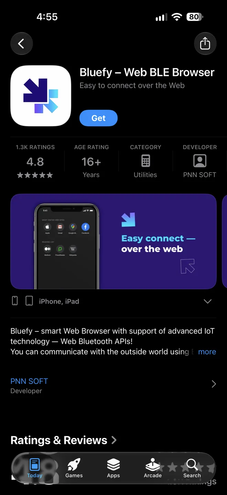
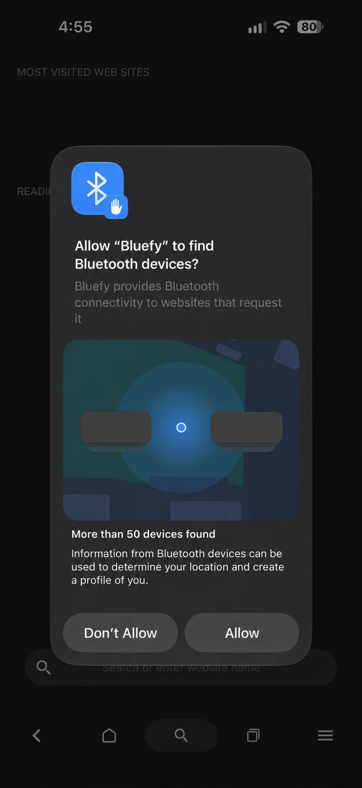
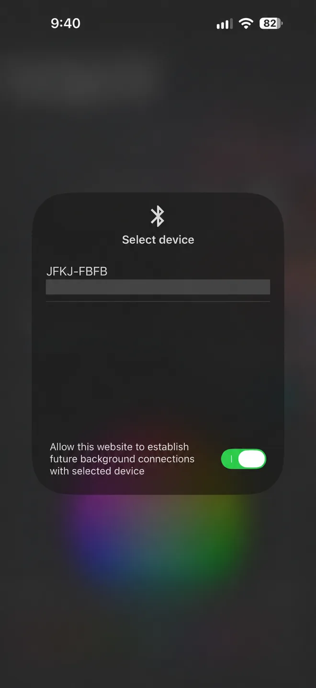
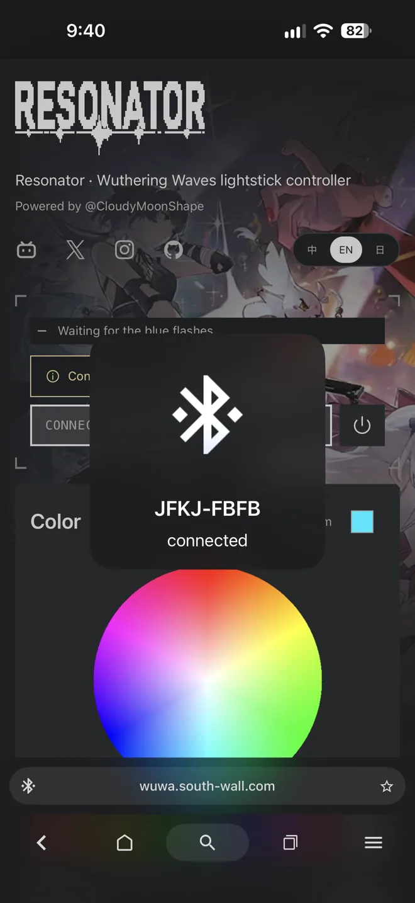
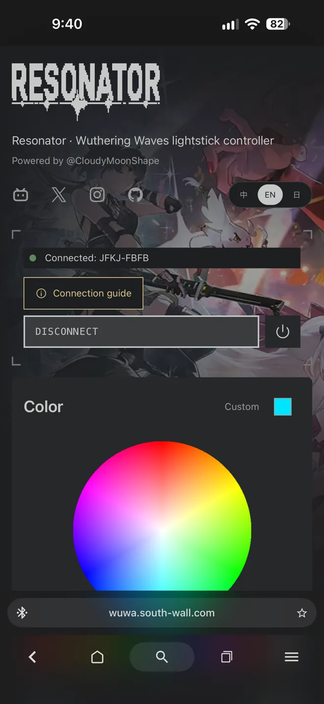

# Connect from iPhone

[Documentation](README.md) · [简体中文](zh-CN/IOS.md) · [日本語](ja/IOS.md)

Use Bluefy to connect this website to your lightstick. Safari and Chrome on iPhone do not provide native Web Bluetooth.

These user-supplied screenshots show a successful Bluefy connection. They do not verify every effect or music feature. Device names and identifiers were concealed in two illustrations. The screenshots use the English app interface.

Cannot connect, or keep losing the connection? The batteries may be depleted. Replace the full set with new batteries and try again. If it still fails, check Bluetooth permission and close other pages or apps connected to the lightstick.

## 1. Install Bluefy

Find **Bluefy – Web BLE Browser** in the App Store. Check that the developer is PNN Soft.

## 2. Allow Bluetooth

Open Bluefy. Select **Allow** when iOS requests Bluetooth access.

## 3. Select the lightstick

Open https://wuwa.south-wall.com/ in Bluefy. Select **Connect lightstick**, then **JFKJ-FBFB**. Background connections are not required.

## 4. Wait for the blue flashes

Bluefy can show **connected** before the website completes its check. Wait for the blue flashes to finish.

## 5. Start controlling

When the website shows **Connected: JFKJ-FBFB**, select a color or effect.

