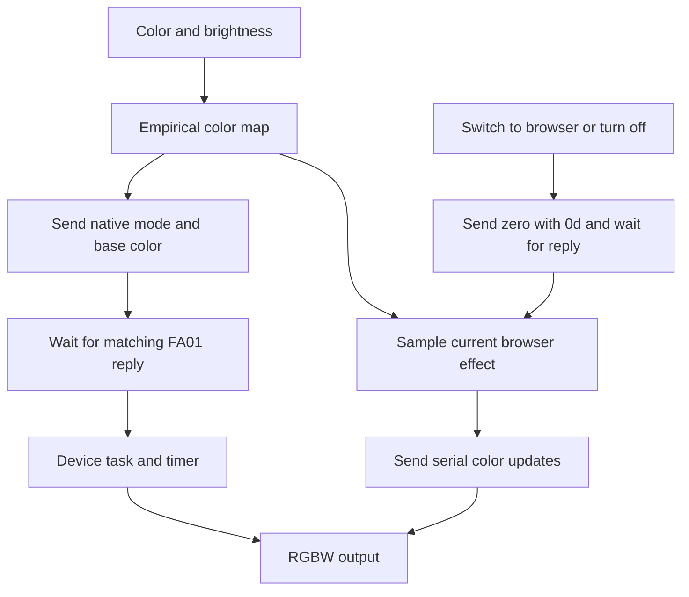

# Native effects

[中文](zh-CN/NATIVE-EFFECTS.md) · [SDK](SDK.md)

[Native breathing](https://wuwa.south-wall.com/?engine=native) · [Extended effects](https://wuwa.south-wall.com/?engine=web) · [Music](https://wuwa.south-wall.com/?engine=music)

Native effects run inside the lightstick. The browser sends a mode command instead of sending each animation frame.

This document records static analysis of the reference firmware and software checks made on 2026-10-24. The operator later reported that native single-color breathing was much smoother on the sample. That report does not verify every effect, mode transition, or reconnect case.

## Browser and firmware roles

| Effect or action | Browser | Firmware |
|---|---|---|
| Single-color breathing | Map the color and set the brightness ceiling. Update the base color when needed. | Run command `02` with an internal timer. |
| Three-color fade or breathing | Select the mode. | Run `03` or `06` with fixed colors and timing. |
| Single-color blinking or RGB steps | Send the color or interval. Require flashing permission. | Run `04` or `05`. |
| Palette cycle or RGB bursts | Select the mode. Require flashing permission for bursts. | Run `08` with 15 presets, or `07` with five flashes per primary color. |
| Custom effects and music | Calculate frames and apply the color map. | Output each received color. |
| Continuous color | Apply the existing color and brightness algorithms. | Use `0e`, except for equal nonzero RGB values. |
| Stop or switch off | Serialize the transition and wait for a matching reply. | Stop the effect and output zero through `0d`. |

The home page gives equal priority to native effects, extended effects, and music. The ordinary URL starts in native steady mode. `?engine=native` selects native breathing. `?engine=web` starts with the browser steady mode. `?engine=music` opens the audio controls.

Each section retains its selection for the current session. Leaving music stops the audio source. Without a source, music output is zero. If an audio permission request completes after the user leaves music, the source is released.

A session that starts in native or music mode uses the protected continuous-color path. Extended effects keep that path after a switch from either section. A session that starts directly with `?engine=web` and never switches sections retains `01` for comparison.

Browser breathing takes about 3.93 seconds at 1×. Native breathing takes about 2.6 seconds. Compare smoothness separately from speed and phase.



## Command frames

`cc = -sum(all preceding bytes) mod 256`. Color bytes use **G, R, B** order. Send `00` as the second byte.

The reply starts with `command | 0xa0`. The reply includes the corresponding parameters and checksum. The second byte of the `03` reply is zero. These layouts come from static analysis. Except for the reported single-color breathing check, individual effects still need hardware acceptance tests.

| Command | Request | Meaning and limit | Reply bytes |
|---|---|---|---:|
| `01` | `01 00 G R B cc` | Set color. If the previous command was `02` or `04`, update only the effect base color. It does **not** exit that effect. | 6 |
| `02` | `02 00 G R B cc` | Single-color breathing, internal mode 2. Change rise/fall phase every 1300 ms; approximately 2600 ms per cycle. No speed parameter. | 6 |
| `03` | `03 00 cc` | Three-channel fade. Start at zero, then transfer between channels. An event changes one level approximately every 4 ms, with a threshold of 250. | 3 |
| `04` | `04 00 G R B HI LO cc` | Blink one color. Toggle every `HI×256+LO` ms. A full cycle takes twice that interval. | 8 |
| `05` | `05 00 HI LO cc` | Cycle red, green, and blue. Hold each color for the interval. Brightness is fixed by firmware. | 5 |
| `06` | `06 00 cc` | Breathe through red, green, and blue. Change rise/fall phase every 1300 ms. The full sequence takes about 7.8 seconds. | 3 |
| `07` | `07 00 f9` | Flash red, green, and blue five times each. Each on/off stage takes 95 ms. Colors, brightness, and timing are fixed. | 3 |
| `08` | `08 00 f8` | Cycle 15 firmware presets. Hold each for about 580 ms. These are not the browser palette. | 3 |
| `0d` | `0d 00 G R B cc` | Stop the internal effect, then output color. The browser uses only zero as an explicit exit command. | 6 |
| `0e` | `0e 00 G R B cc` | Repeated `0e` skips the clear/stop stage. If the previous command differs, it stops the effect first. | 6 |

For `04` and `05`, use an integer interval from 1 to 65534 ms. Values 0 and 65535 do not start the corresponding timer. Browser speed 0.1×–3× maps to `round(250 / speed)` ms. The SDK accepts raw milliseconds. Flashing is off by default.

**Use the white-channel guard.** With `01`, equal nonzero RGB values set W brightness from the value. With `0d` or `0e`, equal nonzero RGB values turn W fully on. Sending `[30,30,30]` through `0e` would therefore produce full white output. `continuousColorFrame()` uses `01` for equal nonzero values and `0e` for other colors or zero.

## Branches not exposed by the SDK

| Entry | Static observation | Limit |
|---|---|---|
| `09` | Combined preset sequence with short on/off stages. | The full stage sequence is not modeled. |
| `0a` | Seven-color preset cycle; related interval is 580 ms. | It has no direct equivalence to the browser color wheel. |
| `0b` | Three long white flashes, three short flashes, three long flashes, then a pause. | Not exposed. Do not label it a standard distress signal from shape alone. |
| `0c` | Red, off, blue, off; approximately 165 ms per stage. | Not exposed. The browser uses the three-color burst option instead. |
| Button presets 18–21 | Internal mode 7: repeating white, red, green, or blue breathing. | No ordinary GATT entry to select mode 7 has been found. Command `02` is not the same implementation. |
| Venue broadcast | Separate group, brightness, and preset paths. | Not part of the browser GATT interface. No RF transmitter is included. |

The physical button has 25 presets. Presets 1–17 are steady colors, including low and high white. Presets 18–21 breathe white, red, green, or blue. Presets 22–25 blink those colors. The button and `08` use different color tables. Their indices are not interchangeable.

The analyzed GATT branches did not reveal an independent high-resolution brightness parameter, arbitrary fade duration, or animation queue. This is a limit of the inspected interface, not proof of a chip limit.

## Functions and state

Reference firmware SHA-256:

```text
8be1f64cd4b084e213e353f449ced36b8dd835e3dbcf7e6e1628f48db281182c
```

Addresses apply only to this firmware mapping. Names below describe observed behavior. They are not original vendor symbols.

| Address | Static interpretation |
|---|---|
| `0x1fff6774` | GATT validation and dispatch. `0x1fff683c` is a switch8 table. Do not rely on the failed decompiler switch reconstruction. |
| `0x1fff67be` | Read the previous GATT command. After command 2 or 4, `01` updates the base color only. |
| `0x1fff6824` | Repeated `0e` skips clear/stop. Other cases call `0x1fff5658(0)` and `0x1fff3990`. |
| `0x1fff68cc` / `0x1fff6912` | Store the selected GRB values for `02` / `04`, then start the corresponding task. |
| `0x1fff6a64` | Shared direct output for `0d` / `0e`. Equal nonzero RGB sets full W. |
| `0x1fff3990` | Clear effect state and stop several OSAL timers. This does not prove that all queued events are removed. |
| `0x1fff7c60` | Effect task. `02` uses event 4; `03` uses event 2; `04`, `05`, and `06` use events 8, 16, and 32. |
| `0x1fff8398` | Hardware timer callback. Internal mode 2 calls `0x1fff3b8c`; mode 7 calls `0x1fff3c18`. |
| `0x1fff3b8c` | Internal counter and output gating. Each step changes one level. The task changes direction. |
| `0x1fff3c18` | Button breathing branch. Each step changes two levels and reverses at its bounds. It differs from `02`. |
| `0x1fff3a74` → `0x1fff5350` | Button handling → preset selection. The latter has another switch8 table. |
| `0x1fff581c` / `0x1fff5948` | Set channel PWM compare values / apply four-channel values. This does not establish a higher-resolution GATT interface. |
| `0x1fff8c70` / `0x1fff8c63` | Previous GATT command / internal timer mode. These are different number spaces. |
| `0x1fff8c80..82` | Selected color storage: three GRB bytes. |

An internal timer load constant of 30 was found. Its clock unit, duty cycle, and actual frequency were not independently measured. Do not report a measured 33 kHz frequency or treat this constant as Bluetooth throughput.

Native breathing uses internal timing instead of browser and packet timing for each small step. The operator reported smoother output. PWM waveform, exact period, and the difference from button breathing still need measurements.

To reproduce the analysis, follow [Ghidra setup](../re/README.md) with your own backup. Run:

```bash
python3 re/inspect_native.py /path/to/your/read1.bin
```

The script reads the file and reports addresses and metadata. The repository does not contain firmware or decompiled vendor code.

## Mode transitions

`DevicePlayback` serializes changes and keeps only the latest intent. Each native start or stop waits up to 1500 ms for a complete matching FA01 reply. A missing or invalid reply causes a disconnect. The code does not silently switch to another effect. A reply confirms command processing, not an optical result.

During a native single-color effect, `FrameSender` samples only the base color and brightness. It sends nothing when they do not change. Color updates use `01` to retain the internal phase. Fixed RGB presets, palette cycles, and bursts do not start the color sender.

When the page becomes hidden, host updates stop. Returning to the page does not resend the native start command. Continued playback during system suspension or Bluetooth disconnection is not guaranteed by a hardware test.

Before a browser effect or an off action, send `0d 00 00 00 00 f3` and wait for its reply. Do not use `03` as reset: it starts a fade. Do not treat zero through `01` as a full exit from native breathing.

`0d` is more explicit than zero through `0e`. It stops the effect even if a button press changed the internal mode while the last GATT command remained `0e`. There is no mode-query interface. Avoid simultaneous button and browser control.

## Hardware checks still required

1. Compare browser, native, and button breathing with the same color and brightness. Record low-brightness steps separately.
2. During native breathing, select red, pink, and white. Change brightness. Check that breathing continues and white can dim.
3. Start three-color fade and three-color breathing. Return to steady output, then turn off. Check that old effects do not restart.
4. Switch browser tabs and return. Check playback. A stable native effect normally needs zero browser writes per second.

Software tests cover frame layouts, invalid replies, replies that arrive before writes complete, disconnection, reordered transitions, color updates, white handling, and stop barriers. A simulated 10-second native breath does not continuously send breathing frames. Simulation does not measure chip throughput or replace hardware checks.
