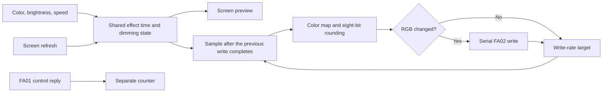

# Output timing

[中文](zh-CN/OUTPUT-TIMING.md) · [90 writes/s target](https://wuwa.south-wall.com/?engine=web&rate=90) · [120 writes/s target](https://wuwa.south-wall.com/?engine=web&rate=120)

Extended effects and music default to a target limit of 60 writes per second. The links above select the extended engine with a higher limit. They do not change the color map, brightness curve, or breathing period. Native breathing runs inside the lightstick and does not use this frame limit.

Open connection details to select 60, 90, or 120 without reconnecting. The URL retains the selection. To compare settings, use the same color, brightness, and 3× browser breathing speed. Observe the light and the write/reply counts.

## Scheduling

The earlier sender used `requestAnimationFrame`. A 60 Hz screen could produce at most about 60 new samples per second. `FrameSender` in `web/output.js` now schedules output separately. Screen preview still follows screen refresh.

Stateless effects calculate the current color when a write is possible. Audio analysis and stateful music effects update with the interface. This avoids counting a beat twice or accelerating hue drift.

Only one write can be in progress. The sender does not queue old samples. If a write takes longer than the target interval, the next write uses the current frame immediately. Equal RGB values are not sent again. Hiding the page, disconnecting, or stopping the effect cancels output. A resumed sender samples the current state. Late results from an old connection cannot replace the new sender state.

The browser-specific SDK client uses `minGapMs: 0`. `FrameSender` supplies the delay, so two limiters do not add their waits. The public `LightstickClient` still defaults to `1000 / 60` ms. A zero SDK delay does not imply unlimited link speed.

## Counters and limits

| Reading | Meaning |
|---|---|
| Rate limit | Software target for browser-generated frames. It is not measured light refresh or native-effect speed. |
| Writes | Completed browser color/control writes, divided by elapsed time. |
| Replies | FA01 replies `a1–a8`, `ad`, and `ae` with a known length, required zero parameter byte, and valid checksum. |
| Write time | Moving average of the browser write Promise duration. It is not complete audio-to-light latency. |

Waits round up to integer milliseconds. With an ideal 2 ms write, the three targets give approximately 17, 12, and 9 ms between write starts: about 59, 83, and 111 samples per second. Deduplication, browser scheduling, and link delay can reduce actual writes further. A link that needs 35 ms per write cannot exceed about 29 writes per second by raising the target.

Static analysis shows that the FA02 callback copies data to one buffer and schedules processing about 10 ms later. Faster writes may replace an intermediate state before processing. Timer restart behavior and actual throughput still need hardware tests. The 120 setting can therefore perform worse than 90. The 10 ms delay is not a measured 100 Hz hard limit.

Replies have no per-frame sequence number. Counts cannot identify every write/reply pair and do not measure optical output. If writes rise while replies fall, or the effect looks worse, compare 90 and 60 in the same connection.

Each channel still has only 256 values. Faster sampling changes time resolution, not the number of brightness levels. No temporal dithering is added.

[Native effects](NATIVE-EFFECTS.md) avoid frame-by-frame breathing updates. Sessions that use the native or music section also use `0e` continuous color, with `01` retained for white. A session opened directly with `?engine=web` and not switched to another section retains the old output path for comparison.

## Software checks

Virtual-clock tests cover sampling above 60 Hz, slow writes, current-frame selection, duplicate colors, rate changes, stop/resume, late failures, and reply filtering. Tests with the real SDK and simulated GATT also check single-write serialization and GRB bytes.

A four-second simulation used 2 ms writes, pure red at 100%, 3× breathing, and a 60 Hz interface. The 60 setting sent 227 frames; 120 sent 406. The maximum adjacent red-channel change fell from 12 to 6. This validates the software path only. It does not measure Bluetooth throughput or light output.
