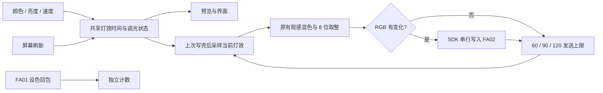

# 高发送率试验

[打开 120 档](https://wuwa.south-wall.com/?engine=web&rate=120) · [打开 90 档](https://wuwa.south-wall.com/?engine=web&rate=90)

延伸灯效和音乐律动的逐帧输出默认上限为 60 次/秒。试验链接进入延伸灯效，选择「调速呼吸」后比较；链接只改变发送上限，颜色、亮度曲线与呼吸周期沿用当前版本。原生呼吸由灯棒内部运行，不受此上限影响。展开「连接详情」可在 60 / 90 / 120 间切换，无需重新连接蓝牙；所选档位保存在当前网址，刷新保留。推荐用相同颜色、亮度和 3× 速度依次比较，观察真实灯光，以及写入和设色回包次数。

## 从屏幕刷新中独立

原网页把输出绑在 `requestAnimationFrame` 上，60 Hz 屏幕每秒最多产生约 60 个新采样。现在 `web/output.js` 的 `FrameSender` 单独安排采样与写入；屏幕预览仍随屏幕刷新。普通呼吸等无内部状态的灯效，每次真正有机会发报时重新计算当前时刻的颜色。音乐分析和有内部状态的音乐灯效只随界面更新，避免多计节拍或加快色相漂移。

调度器保持一个写操作在途，不排队补发旧采样。一次写入超过目标间隔时，写完就取当前帧；相同 RGB 不重复发送。页面隐藏、断线或停止灯效时取消输出，恢复后重新取当前帧。旧连接迟到的完成或失败不会覆盖新一轮发送状态。

网页专用 SDK 实例传入 `minGapMs: 0`，由 `FrameSender` 统一限速，避免两个等待器叠加。公开 `LightstickClient` 的默认最小间隔仍是 `1000 / 60` ms；开发者不能只把 SDK 间隔设为零就认为链路能无限提速。

## 读数与实际限制

| 显示 | 意义 |
|---|---|
| 发送上限 | 网页逐帧发送的软件目标；60 / 90 / 120 不是实测灯光刷新率，也不调节内置灯效速度 |
| 写入次数 | 浏览器成功完成设色写操作的次数，按实际经过时间换算 |
| 指令回包 | FA01 中 `a1–a6`、`ad`、`ae` 对应已知长度、零参数位和有效校验的控制回复次数 |
| 写入耗时 | 浏览器写操作 Promise 的耗时滑动平均，不是完整声光延迟 |

等待时间向上取整为整数毫秒。理想的 2 ms 写入下，三个档位的相邻开始间隔分别约为 17 / 12 / 9 ms，即约 59 / 83 / 111 次采样每秒。相同 RGB 去重、浏览器调度和链路延迟会进一步降低实际写入次数；35 ms 才完成一次写入的链路不能靠调高上限突破约 29 次/秒。

已分析固件的 FA02 回调先复制到单个缓冲区，约 10 ms 后处理。更密的指令可能在处理前覆盖中间状态；定时器的重启行为与实际吞吐还需实物验证，因此 120 档不一定比 90 档更顺，不能把 10 ms 直接当成已测得的 100 Hz 硬上限。回包没有逐帧序号，统计不能完美对应每次写入，也不代表 LED 的光学输出已经测量。若写入很多、回包偏少或观感更差，请在同一连接里切到 90 或 60 对照。

每通道仍为 8 位，增加采样只能细化时间上的间隔，不会增加 0–255 的物理档位。本页描述的提高发送率本身不改变混色或调光曲线；不加入时间抖动。后续新增 [内置能力试验](NATIVE-EFFECTS.md)，用内部计时取代逐帧发送的呼吸，并为试验会话提供 `0e` 连续设色；白光保持 `01`。当前首页提供原生、延伸、音乐三个入口；普通网址默认原生常亮，直接打开 `?engine=web` 且未切换入口时保留原输出路径作比较。

## 软件验证

虚拟时钟覆盖高于 60 Hz 的独立采样、慢链路不叠加等待、最新颜色采样、相同 RGB 去重、切档、停止/恢复、旧连接迟到失败与回包过滤。另通过真实 SDK 搭配模拟 GATT，检查单次写入、有效 GRB 字节与 60 Hz 界面下的高频输出。

在 2 ms 写入、100% 纯红、3× 呼吸、60 Hz 界面的 4 秒模拟中，60 档发送 227 帧，120 档发送 406 帧；最大相邻 R 变化从 12 降至 6。此结果仅验证软件路径，尚未测量真实蓝牙吞吐与灯光；试验版由用户用灯棒比较。
