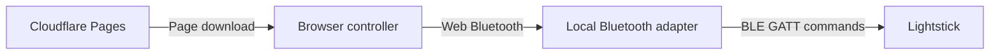

# JavaScript SDK

[简体中文](zh-CN/SDK.md)

Use this host-side SDK to control your lightstick through Web Bluetooth. It is independent project code. It is not the chip manufacturer's firmware SDK. Manufacturer code, firmware, decompiled output, and third-party serial tools are not included. See [firmware analysis](../re/README.md) for the separate research workflow.

## Start

1. From the repository root, run `python3 -m http.server 8765`.
2. Open `http://localhost:8765/sdk/examples/color.html` in a browser with Web Bluetooth support.
3. Select **Connect**. Choose your lightstick in the browser's device dialog.

The example needs no package installation. A remote host must use HTTPS. A user action, such as a button click, must start the connection.

```js
// This import path assumes a module at the repository root.
import { LightstickClient, colorFrame } from './web/sdk.js';
const stick = new LightstickClient({
  onState(state, detail) { console.log(state, detail); },
  onNotification(bytes) { console.log('Device reply', bytes); }
});
// Run in a button handler. Catch connection and write errors.
await stick.connect();
await stick.setColor([255, 0, 0]); // RGB input; GRB on the wire.
await stick.setColor([0, 0, 0]);   // Turn the light off.
stick.disconnect();              // Disconnect does not turn the light off.
console.log(colorFrame([12, 34, 56])); // 01 00 22 0c 38 99
```

Node can import `sdk/index.mjs` for frame functions. Node does not provide the browser Bluetooth API by default. Run `node --test tests/sdk.test.mjs` for simulated transport tests. These tests do not connect to hardware.

## Browser support

The controller checks for a secure context and `navigator.bluetooth.requestDevice`. It does not reject a device by its model name.

Chrome on Windows, macOS, ChromeOS, and Android provides the required interface. Edge on Windows and macOS also supports the controller path. Linux Chrome support remains experimental; do not assume it works without configuration. Standard Safari and Chrome on iPhone and iPad do not provide native Web Bluetooth. HTTPS, a home-screen shortcut, or a PWA cannot add this interface.

If the interface is absent, the page disables connection and keeps screen previews available. It does not ask users to install another browser, app, or extension. An extension with a native Bluetooth bridge is a separate installation, not native browser support.

See [Chrome Bluetooth help](https://support.google.com/chrome/answer/6362090?hl=en) and the [Web Bluetooth implementation status](https://github.com/whatwg/bluetooth/blob/main/implementation-status.md).



The SDK connects to the service, subscribes to notifications, and checks the handshake echo. Control commands then travel directly from the browser to the lightstick. They do not pass through Cloudflare.

System support for Bluetooth headphones does not give a web page access to BLE devices. An iPhone relay through another nearby computer could provide an alternative path. This project does not implement that relay.

## API

| API | Behavior |
|---|---|
| `frame(body)` | Return bytes with a negative-sum checksum. Send nothing. Require a nonempty sequence of integers from 0 to 255. |
| `colorFrame([r,g,b])` | Return `01 00 G R B checksum` as a `Uint8Array`. Validate all three input values. |
| `validChecksum(bytes)` | Return whether a nonempty byte sequence sums to 0 modulo 256. This does not validate command meaning or identity. |
| `new LightstickClient(options)` | Accept optional `onState`, `onNotification`, and `onWrite(bytes, elapsedMs)` callbacks. Keep callbacks short. Do not throw from them. |
| `connect()` | Open the device dialog. Connect to FA00 and subscribe to FA01. Write the handshake to FA02. Require an exact echo within 4000 ms, then wait 1200 ms for the blue animation. Return the device. Reject concurrent connection calls. |
| `setColor([r,g,b])` | Return a Promise. Resolve to `true` when the browser write completes. Resolve to `false` if a newer pending command replaces this one. Reject on disconnect or write failure. |
| `nativeEffectFrame(kind, options)` | Build a validated frame for `breathe`, `fade`, `blink`, `rgb-step`, `rgb-breathe`, `palette-cycle`, or `rgb-burst`. Send nothing. |
| `continuousColorFrame(rgb)` | Use `0e` for unequal channels or all-zero input. Use `01` for equal, nonzero channels to avoid full white output. |
| `setNativeEffect(kind, options)` | Start a native effect. Resolve to `true` only after both the write and matching FA01 reply. Disconnect on reply timeout. |
| `stopNativeEffect()` | Send a zero-color `0d` frame. Wait for its matching reply. Stop the effect and turn the light off. |
| `setContinuousColor(rgb)` | Send continuous direct color. First call and await `stopNativeEffect()` to establish direct-output mode. |
| `disconnect()` | Cancel pending commands, remove listeners, and close GATT. Connection steps also check for cancellation. |
| `ready`, `state`, `device` | Read connection readiness, the state name, and the current device. `device` is `null` when disconnected. |

Connection states are `selecting → connecting → authenticating → ready`. Failure changes the state to `error`. Disconnection changes it to `disconnected`.

`ready` requires a completed handshake write, an exact FA01 echo, and the animation wait. A missing or incorrect echo causes a timeout and disconnection. The echo is a protocol handshake, not cryptographic authentication.

A successful color write proves that the browser completed the write. It does not prove the optical output. FA01 replies are separate observations. Do not report GATT write duration as measured light or audio latency.

## Send timing

Only one write can be in progress. The pending slot holds only the latest command. This prevents old animation frames from accumulating.

The SDK prefers a write without response. It falls back to a write with response. The default target limit is 60 writes per second. `minGapMs` sets the minimum interval between write starts. Its default is `1000 / 60` ms. Write duration counts toward this interval.

If a write takes longer than the interval, the SDK sends the latest pending command when it can. It does not add another fixed delay or send old frames in parallel. Browser scheduling, the Bluetooth link, and firmware processing can reduce the actual rate.

The controller sends only changed values. Its `FrameSender` samples independently of screen refresh. The `?rate=90` and `?rate=120` options select experimental target rates. That client uses `minGapMs: 0`; the outer sender controls timing. The public SDK default remains unchanged. See [output timing](OUTPUT-TIMING.md).

Connection details count completed control writes and valid control replies. They do not measure optical refresh rate. A stable native effect usually needs no repeated writes. The owner confirmed that native single-color breathing looks smooth. Other native commands still need individual hardware tests.

## Native effects

```js
// Run after connection in an async handler. Catch errors and check return values.
const started = await stick.setNativeEffect('breathe', {rgb: [255, 32, 32]});
if (!started) throw new Error('A newer command replaced the effect request');
// The firmware continues the effect. Do not resend its start command in a loop.
await stick.setColor([255, 16, 16]); // Change the base color; retain the phase.
const stopped = await stick.stopNativeEffect();
if (!stopped) throw new Error('A newer command replaced the stop request');
await stick.setContinuousColor([80, 0, 0]);
```

| Effect | Options |
|---|---|
| `breathe` | `rgb` |
| `blink` | `rgb`, `intervalMs` |
| `rgb-step` | `intervalMs` |
| `fade`, `rgb-breathe`, `palette-cycle`, `rgb-burst` | None |

Intervals must be integers from 1 to 65534 ms. `palette-cycle` uses 15 firmware colors (`08 00 f8`). `rgb-burst` uses repeated RGB flashes (`07 00 f9`). Require the user to enable flashing before starting this effect.

The SDK does not apply the controller's color mapping. See the [native-effect example](../sdk/examples/native.html).

Start and stop commands wait up to 1500 ms for a matching reply by default. Set `replyTimeoutMs` to change this limit. They share the single write slot with color commands. A pending command replaced by a newer one resolves to `false`.

Await mode changes in sequence. Check each result before sending a color. The controller uses `DevicePlayback` for this task. A reply can arrive before the browser write completes; the SDK waits for both.

In modes `02` and `04`, command `01` changes only the base color. It does not exit the mode. Command `03` starts a fade; it is not a reset. Native breathing has a fixed speed. The physical button uses a separate internal mode 7. Their behavior is not assumed to be identical. See [native effects](NATIVE-EFFECTS.md).

## Firmware evidence

| Item | Meaning | Evidence and limits |
|---|---|---|
| `FA00 / FA01 / FA02` | Control service / read and notify / write | Historical device tests with the original tools. |
| `JFKJ-20250421` | Plaintext handshake; stops the approximately 8-second disconnect timer | Static analysis and device tests. This is not a user account secret. |
| `0x01` | Six-byte color command: `01 xx G R B checksum`; use `xx=0` | GRB order, red, green, and off were tested on the sample. |
| `R=G=B≠0` | Select the white channel | Static analysis and earlier white-balance observations. Equal values do not independently drive three RGB channels. |
| Reply prefix `0xa1` | Possible reply to a color update in modes 2 and 4 | Historical records. It is not another documented color command. |
| `0x02–0x08` | Implemented native effects | Static analysis and simulated tests. The owner confirmed the smooth appearance of `02`; others need individual device tests. |
| `0x09–0x0c` | Combined, seven-color, white, and red/blue patterns | No SDK device-call wrappers. |
| `0x0d / 0x0e` | Stop and direct output / continuous color | Static analysis. Equal, nonzero RGB selects full white in these branches. |

## Firmware addresses

These are descriptive names from the research notes, not manufacturer symbols. Addresses apply only to the reference firmware. They are not JavaScript-callable functions or a stable ABI. C prototypes are not sufficiently established.

| Address | Name | Behavior |
|---|---|---|
| `0x1fff4290` | FA02 write callback | Copy input to `0x1fffc343`; process it about 10 ms later. Input-length checks need more analysis. |
| `0x1fff6774` | GATT dispatcher | Compare the handshake, check the checksum, and dispatch by command byte. |
| `0x1fff2fd4` | Raw RF task handler | OSAL task 10; separate from normal GATT control. |
| `0x1fff73c0` | Raw RF receive handler | Filter AdvA and pass the payload to the parser. |
| `0x1fff6b14` | Venue payload parser | Apply XOR decoding, check the sum, and dispatch by group and type. No RF test. |
| `0x1fff7c60` | Light-effect task | OSAL task 11; controls the output path. |
| `0x1fffc1cc` | RF configuration data | `+0x20`: format, whitening, CRC; `+0x24`: CRC initial value; `+0x28`: Access Address; `+0x40`: frequency. |

See [Ghidra setup](../re/README.md) and the [function reference](FUNCTIONS.md). Report the board, firmware hash, address, input bytes, reply bytes, steps, and visible result with each new finding. Keep static inference separate from device observations. A decompiler's guessed signature is not a verified prototype.

`scripts/venue_packet.py` generates venue protocol bytes, not RF signals. Venue color bytes use RGB; GATT uses GRB. Do not transmit venue packets at an event. Type 6 can persistently change other devices' groups. The SDK does not expose venue transmission, arbitrary device commands, or OTA writes to `5833ff01`.

## Color and brightness

`setColor` takes raw RGB drive values. The controller applies `renderColor` from `web/color.js` before calling the SDK. Do not apply that mapping twice. See [color mixing](COLOR-MIXING.md).

`web/dimming.js` produces brightness factors for the slider and browser-generated breathing. The slider uses smoothing and a mild quadratic curve. Breathing uses a continuous envelope. `renderColor` rounds the final channel values.

The SDK does not apply these curves. `[128,0,0]` still sends raw red value 128. See [dimming](DIMMING.md) for the 8-bit limits at low output.
