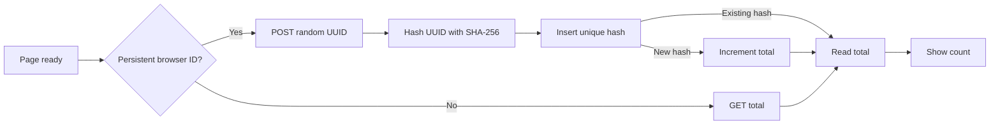

# Visitor counter

[Documentation](README.md) · [简体中文](zh-CN/VISITORS.md)

The header shows the number of browser identities that registered after counting began. It starts at zero. It does not count people, Bluetooth connections, or lightsticks. On a narrow screen, the count sits to the right of the logo.

## Data flow



The browser creates a UUID v4 with `crypto.randomUUID()`. It stores the ID in `localStorage` under `wuwa.visitor.v1`. It submits the same ID on later visits to that origin.

The server converts the ID to lowercase, hashes it with SHA-256, and stores only the hash. A primary key prevents duplicate records. An `AFTER INSERT` trigger increments the single row in `visitor_totals`. The insert and total query run in one D1 `batch()`.

The counter database stores no raw UUID, IP address, User-Agent, timestamp, Bluetooth data, or control activity. The request omits cookies and the referrer. Cloudflare still processes normal HTTP traffic data.

## Counting limits

- Refreshes and control actions reuse the stored identity.
- Web Locks serializes first-time ID creation across tabs when the browser supports it. Without Web Locks, simultaneous first visits can create more than one ID.
- Storage is separate for each origin. A visit to each official domain can count twice in the same browser.
- A different browser, profile, device, cleared storage, or new private session can count again.
- If persistent storage fails, the page reads the total without registering an ID.
- A script can submit new UUIDs. Origin and input checks are not a complete abuse prevention system.

Use the count as a community metric. Do not present it as an exact number of people.

## Page integration

Keep these element IDs:

```html
<div id="visitorCount" class="visitor-count" hidden>
  <span id="visitorTotal" class="ms-readout"></span>
  <span class="web-small">browsers visited</span>
</div>
```

Load [visitors.js](../web/visitors.js) once. It has no exported API. The build embeds it in the controller HTML. It requests the count after the DOM is ready and does not poll. It hides the counter on failure or after a six-second timeout. Bluetooth initialization does not wait for it.

Only the two configured production HTTPS origins send requests. Localhost, branch previews, and temporary deployment domains do not create IDs or contact the counter. The API rejects those origins too.

## API

[functions/api/visitors.js](../functions/api/visitors.js) serves `/api/visitors`. It requires a D1 binding named `VISITORS_DB`.

| Request | Result |
|---|---|
| `GET /api/visitors` | Read the total: `200 {"total":0}`. |
| `POST /api/visitors` with `{"id":"UUID-v4"}` | Register once, then return the total. Repeated IDs do not increment it. |

POST requires a matching `Origin`, `application/json`, and exactly one UUID v4 field. The body limit is 256 bytes. Both the declared length and the received stream are checked.

| Status | Meaning |
|---|---|
| `400` | Invalid input. |
| `403` | Invalid POST origin. |
| `404` | Request URL is not a configured production origin. |
| `405` | Unsupported method. |
| `413` | Body too large. |
| `415` | Wrong content type. |
| `503` | Database missing or unavailable. |

Responses disable browser and CDN caching. They do not expose database diagnostics or enable cross-origin reads.

## Set up your own counter

1. Create a dedicated D1 database in your account.
2. Apply [0001_visitors.sql](../migrations/0001_visitors.sql).
3. Bind `VISITORS_DB` only in the production environment. Use a separate database for tests.
4. Set your database ID in the deployment configuration. A database ID identifies a resource; it is not a credential.
5. Update the allowed origins in the browser script and API.
6. Deploy from the repository root so Wrangler compiles `functions/`.
7. Verify that `dist/_routes.json` routes only `/api/visitors` to Functions.
8. Test duplicate IDs and database failure in the test database. Use GET to inspect the production total; do not fill it with test IDs.

The migration command is:

```sh
npx wrangler@4.152.0 d1 migrations apply YOUR_DATABASE --env production --remote
```

Check the account, environment, and database before you run it. See [Pages D1 bindings](https://developers.cloudflare.com/pages/functions/bindings/#d1-databases), [D1 migrations](https://developers.cloudflare.com/d1/reference/migrations/), and [Functions routing](https://developers.cloudflare.com/pages/functions/routing/#functions-invocation-routes).

## Verification

Run `node --test tests/visitors.test.mjs` with Node.js 24. The tests execute the migration and trigger with `node:sqlite`. They cover duplicate IDs, concurrent requests, rollback, body limits, origin checks, missing bindings, storage failure, Web Locks, timeout, and hidden-on-failure behavior.

Local SQL tests do not verify a production D1 binding or a deployed browser. D1 batch behavior is documented in the [D1 API](https://developers.cloudflare.com/d1/worker-api/d1-database/#batch).
