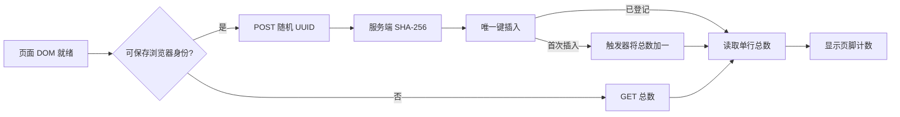

# 到访计数

页脚显示「N 位共鸣者到访」。N 是启用计数后，成功登记过的浏览器身份数；从 0 开始，不补造此前的访问量，也不表示独立人数或灯棒数量。

## 怎么计数



浏览器使用 `crypto.randomUUID()` 生成随机 UUID v4，保存在 `localStorage` 的 `wuwa.visitor.v1`。每次打开页面都提交同一个 ID；服务端把它规范为小写、计算 SHA-256，只保存哈希值。`visitor_ids` 的主键去重，`AFTER INSERT` 触发器仅在真正插入时更新 `visitor_totals` 的唯一一行。插入和读总数放在同一个 D1 `batch()` 中，失败时整体回滚；查询总数不扫描访客表。[D1 事务](https://developers.cloudflare.com/d1/worker-api/d1-database/#batch)、[D1 触发器支持](https://developers.cloudflare.com/d1/sql-api/sql-statements/#pragma-recursive_triggers--onoff)、[SQLite 触发器语义](https://www.sqlite.org/lang_createtrigger.html)

数据库只有哈希值与总数，不保存原始 UUID、IP、User-Agent、时间、蓝牙信息或页面操作。前端不读取蓝牙设备数据，不携带 Cookie，不发送 Referrer，不加载第三方分析 SDK。这里描述的是本计数模块；Cloudflare 接收 HTTP 请求所需的网络处理仍然存在。

同一浏览器的多次刷新、连接与灯效操作不会增加计数。支持 Web Locks 的浏览器会串行初始化 ID，避免多个标签页首次同时打开时生成不同 ID；不支持 Web Locks 的旧浏览器仍会复用已保存的 ID，但首次多标签同时初始化存在竞争窗口。[随机 UUID](https://developer.mozilla.org/en-US/docs/Web/API/Crypto/randomUUID)、[Web Locks](https://developer.mozilla.org/en-US/docs/Web/API/Web_Locks_API)

`localStorage` 按 origin 隔离。`https://wuwa.south-wall.com` 和 `https://wuwa-lightstick.pages.dev` 共用数据库，但各自保存 ID：同一浏览器访问两个域名会计两次。换浏览器、浏览器配置、设备、清除站点数据或重新开启私密浏览会话也可能多计。禁用或无法持久保存 `localStorage` 时只读总数，不生成临时 ID 上报；这类浏览器会漏计。以上是这个轻量计数器的边界。[浏览器存储范围](https://developer.mozilla.org/en-US/docs/Web/API/Window/localStorage)

## 接入页面

页脚提供一个默认隐藏的容器：

```html
<span id="visitorCount" hidden></span>
```

加载 [web/visitors.js](../web/visitors.js) 一次即可，无导出接口、无初始化参数。源码预览可用 `<script defer src="visitors.js"></script>`；发布时将脚本原样内联到独立 `<script>` 中，避免额外脚本请求。不要让蓝牙初始化等待计数请求。

脚本在 DOM 就绪后延后一个任务执行，每次页面加载最多请求一次，不轮询。请求最多等待 6 秒，失败、响应异常或数据库未配置时保持隐藏；页面控制和动画照常运行。仅两个正式 HTTPS origin 会发请求。`localhost`、分支预览和临时部署域名既不请求接口，也不生成 ID。API 同样拒绝这些域名。

## 接口与部署

[functions/api/visitors.js](../functions/api/visitors.js) 对应 `/api/visitors`，需要一个独立 D1 数据库，绑定名固定为 `VISITORS_DB`。无需把任何数据库凭证交给浏览器。[Pages D1 绑定](https://developers.cloudflare.com/pages/functions/bindings/#d1-databases)

| 请求 | 响应 | 行为 |
| --- | --- | --- |
| `GET /api/visitors` | `200 {"total":0}` | 只读取总数 |
| `POST /api/visitors`，JSON `{"id":"UUID-v4"}` | `200 {"total":1}` | 首次登记或幂等重试，返回总数 |

POST 只接受请求 URL 的同源 `Origin`、`application/json` 和一个 UUID v4 字段。请求体最多 256 字节，声明长度与实际流都检查。错误状态为 `400` 输入不合法、`403` 来源不允许、`404` 非正式域名、`405` 方法不支持、`413` 过长、`415` 内容类型不支持、`503` 服务不可用；不会把数据库诊断返回给浏览器。所有响应使用 `Cache-Control: no-store` 与 `CDN-Cache-Control: no-store`，不开放跨域读取。

上线需要：

1. 在项目所属 Cloudflare 账户创建独立 D1 库，并在该库应用 [0001_visitors.sql](../migrations/0001_visitors.sql)。需要数据库创建/写入权限；现有仅能部署 Pages 的凭证不一定有 D1 权限。
2. 给 Pages **Production** 环境绑定 `VISITORS_DB`。预览环境不要绑定正式库。迁移、绑定完成后再重新部署包含 Functions 的版本，绑定才会生效。
3. 通过 Pages CI 或 Wrangler 编译根目录的 `functions/`。`dist/_routes.json` 应仅包含 `{"version":1,"include":["/api/visitors"],"exclude":[]}`，让首页和说明页继续静态直出。[Functions 路由](https://developers.cloudflare.com/pages/functions/routing/#functions-invocation-routes)
4. 在隔离测试库验证同 ID 并发登记只加一、绑定失效时返回 503，再验证正式域名 GET 能读取真实总数。不要用测试 ID 填充正式计数，也不要为了调试临时开放预览域名写正式库。

迁移文件可由 `wrangler d1 migrations apply <实际数据库名> --remote` 应用；先确认目标账户、库名和生产环境绑定一致。[D1 迁移](https://developers.cloudflare.com/d1/reference/migrations/)

UUID、请求长度与同源限制用于约束接口，不是完整防刷方案。脚本可以伪造 Origin 并反复创建 UUID，因此这个数是社区到访指标，不能用于财务结算或声称精确人数。出现真实滥用时再按访问情况增加边缘限流；本模块没有验证码或设备指纹。

## 验证范围

运行 `node --test tests/visitors.test.mjs`，也会被现有 `npm test` 自动发现。本地使用 Node 24 自带的 `node:sqlite` 执行真实迁移与触发器，无新增 npm 依赖；Node 可能提示 SQLite API 为实验性功能。

测试覆盖从零开始、两正式域名、大小写 UUID 规范化、32 个同 ID 并发请求、不同 ID 混合并发、事务回滚、坏输入、流式请求体上限、来源限制、缺失绑定/数据库失败，以及 DOM 后加载、身份复用、多标签锁、无存储只读、预览不上报、失败隐藏和超时中止。本地适配器验证 SQL 逻辑；它不替代实际 D1 绑定、Cloudflare 部署或公网浏览器验收。
