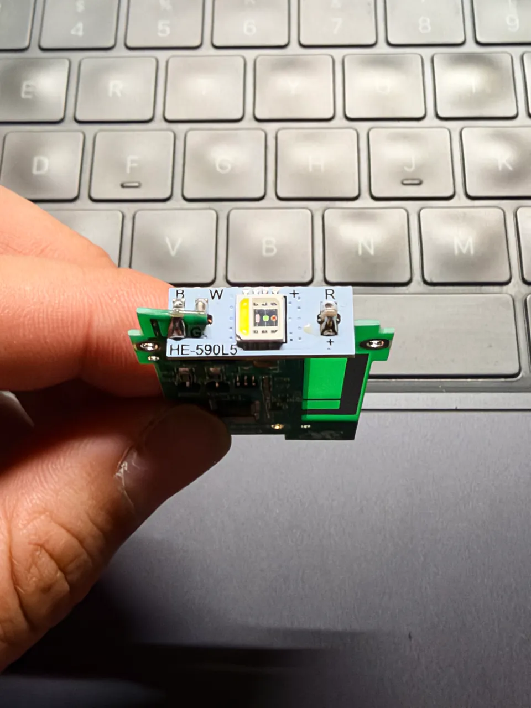
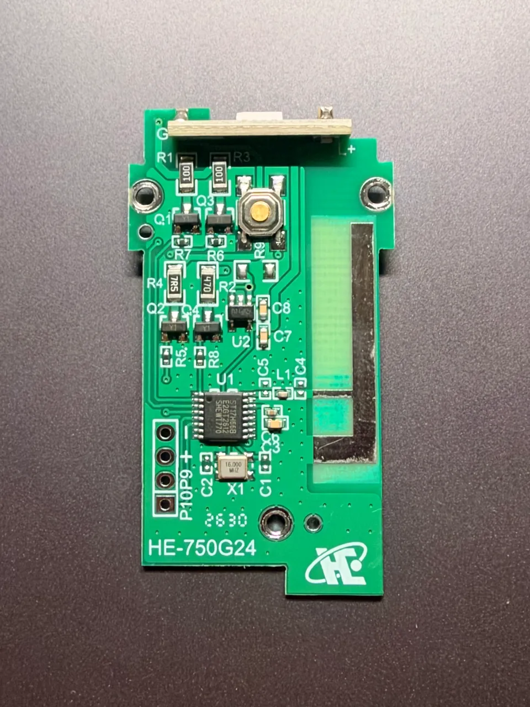
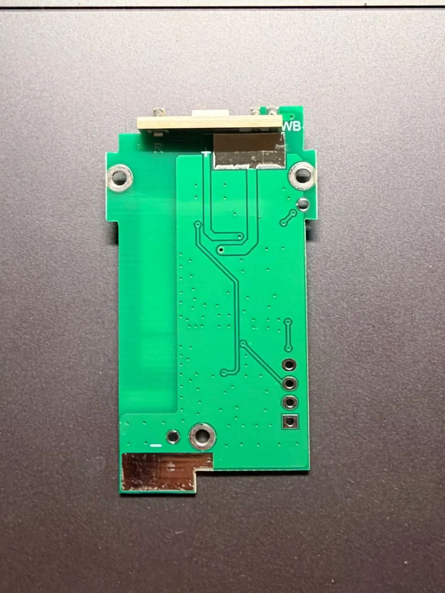
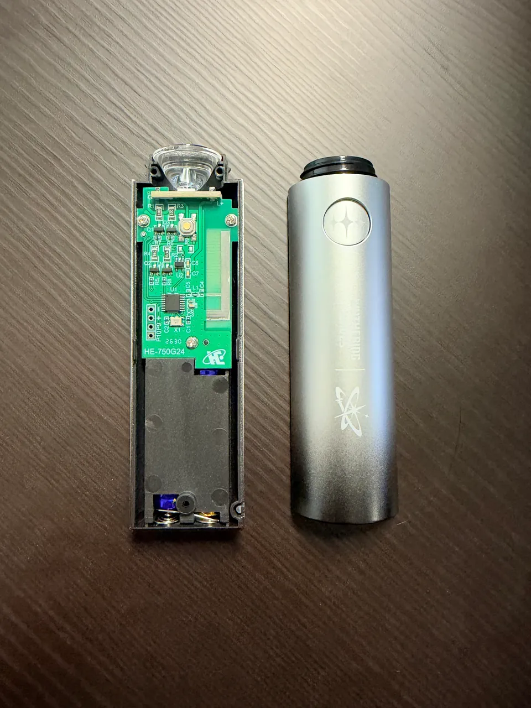

# 硬件实拍

[English](../HARDWARE.md) · [文档](README.md)
[文档](README.md) · [控制协议](PROTOCOL.md) · [开发 SDK](SDK.md)

四张照片均由用户提供，记录本项目研究样机。网页副本保留整图与拍摄方向，仅缩放、转码并清除 EXIF / GPS 等元数据，没有生成或补绘细节。

| HE-590L5 灯板 | HE-750G24 主板正面 |
|---|---|
|  |  |

| 主板背面 | 拆机全貌 |
|---|---|
|  |  |

## 辨认样机

| 位置 | 照片直接可见 | 结合研究记录理解 |
|---|---|---|
| 灯板 | `HE-590L5`，`B`、`W`、`R`、`+` 等标记；封装内有黄色荧光层区域和多个芯片区域 | 与现有 RGBW 四通道研究相符；焊点与遮挡处不能仅凭照片补出完整线路 |
| 主板正面 | `HE-750G24`，U1 上的 `ST17H66B`，标注 `16.000 MHz` 的晶振、按键和 `P10P9` 四孔接口 | 与已研究主板对应；固件版本必须另外从设备读取，不能由外观确定 |
| 主板背面 | 走线、过孔、安装孔与电源触点 | 可用于对照正面定位；不能据此宣称线路已经测通或确定每路 GPIO 对应 |
| 装配 | 灯板与透明光学件的位置、主板安装方式、外壳与电池仓 | 用于辨认结构关系，不是完整拆装教程 |

照片是外观证据。供电、电气连接和信号语义应分别核对测量与协议记录；[协议说明](PROTOCOL.md) 和 [函数目录](FUNCTIONS.md) 保留历史实测、静态逆向及未确认项。

## RGBW 与混色

这颗灯珠包含红、绿、蓝和独立白光通道。`W` 标记与荧光层区域能帮助理解实物结构；下面的控制规则来自既有固件分析和设备记录，而不是从照片推测：

- GATT 设色帧只有三个颜色字节。`R = G = B > 0` 时，固件改用白光通道；三个值都为零时熄灯。
- 因而“发送等值 RGB”在这块棒子上不代表三个彩色通道一起混白。网页对白色、灰色使用该行为，对其他颜色避免四舍五入后意外变成等值。
- 目前未确认通过现有接口同时、独立控制 RGB 和 W 的方法。SDK 不提供未经验证的四通道接口。

白光与 RGB 混色是不同的出光路径。照片无法测得通道亮度、光谱或色准，也不能证明偏色来自固件。网页的经验映射和适用边界见 [观感混色](COLOR-MIXING.md)。

## 继续开发

1. 对照主板、灯板丝印与布局，再读取固件版本。当前记录面向 `HE-750G24` / `HE-590L5`、固件 `V4.1.8`；外观相同不保证协议兼容。
2. 从 [SDK 示例](SDK.md) 连接自己的设备，记录设色输入、回包与可见结果。SDK 接受原始 RGB，网页的观感映射是另一步。
3. 需要追踪内部行为时，从 [函数与证据](FUNCTIONS.md) 找到入口，再按 [逆向环境](../../re/README.zh-CN.md) 使用自己的固件重建分析。
4. 只有需要固件研究时才考虑串口。四孔的位置可由照片辨认，接线与互斥供电要求仍按 [备份说明](PROTOCOL.md) 核对；本轮没有进行电路通断或接线复验。
