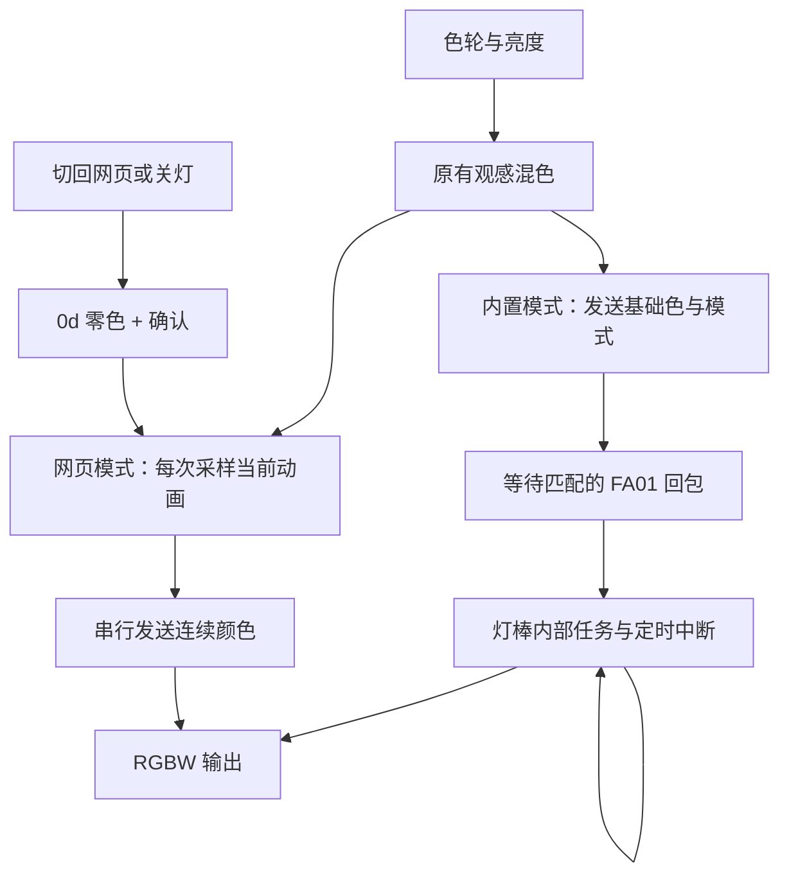

# 原生灯效与扩展玩法

[English](../NATIVE-EFFECTS.md) · [文档](README.md)
[打开内置呼吸](https://wuwa.south-wall.com/?engine=native) · [延伸灯效](https://wuwa.south-wall.com/?engine=web) · [音乐律动](https://wuwa.south-wall.com/?engine=music) · [SDK](SDK.md)

2026-10-24 从「哪些工作应该交给固件」重新追踪 GATT 分发、灯效任务、定时中断和实体按键。这里记录参考固件的静态结论、主机软件与模拟传输检查。用户随后对网页原生单色呼吸给出「好太多了，非常顺滑」的实物反馈；这只确认该样机的主观平滑度，不代表其他灯效或全部退出、重连行为已经验收。

## 这一版改变了什么

| 能力 | 网页负责 | 固件负责 | 本版取舍 |
|---|---|---|---|
| 单色呼吸 | 观感混色、亮度上限；变化时更新基础色 | 用内部定时器调制明暗 | 接入 `02`，不再经蓝牙逐帧生成呼吸 |
| 三色渐变 / 三色呼吸 | 选择模式 | 配色、周期、连续运行 | 接入 `03` / `06`；颜色、亮度和速度不能自由改 |
| 单色闪烁 / 三色跳变 | 颜色或间隔参数 | 定时亮灭 / 换色 | 接入 `04` / `05`，沿用闪光许可开关 |
| 多色轮播 / 三色连闪 | 选择模式；连闪需先允许闪光 | 15 色预设轮播 / 红绿蓝各连闪 5 次 | 新接入 `08` / `07`，固定配色和时序 |
| 自定义渐变、音乐、可调速呼吸 | 动画、音频分析与观感混色 | 按接收值输出 | 继续保留网页引擎 |
| 连续设色 | 原有混色与调光算法 | 连续直出分支 | 从原生或音乐入口开始的会话使用 `0e`；等值白色仍用 `01` |
| 停止 / 关灯 | 串行切换，等待确认 | 停止内部灯效、输出零 | 使用 `0d` 零色作为退出屏障 |

首页提供三个同级入口：**原生灯效、延伸灯效、音乐律动**。普通网址打开原生常亮；`?engine=native` 预选原生呼吸，`?engine=web` 保留原网页常亮对照，`?engine=music` 直接打开音源与音乐玩法。切换入口记住本次会话各自选择，切出音乐会停止音源；无音源时音乐输出为零，迟到的音源权限结果会释放，不会抢回灯光。

原生或音乐入口使用带白光保护的连续设色；选择过这两个入口后，延伸灯效也沿用该路径。仅直接以 `?engine=web` 开始且未切换入口的会话保留原有 `01` 输出，便于比较。对照同一颜色和亮度时，两种呼吸的周期不同：网页约 3.93 秒（1×），内置约 2.6 秒，不能把相位或速度差异误判为平滑度。

## 能复现的协议表

`cc = -sum(前面所有字节) mod 256`；颜色顺序为 **G、R、B**。第二字节发送 `00`。命令回包以 `command | a0` 开头，后续参数与校验见下面各帧；`03` 的回复第二字节固定为零。网页只提供以下已追踪布局的命令，不向 OTA 或现场射频入口写入。

| 命令 | 请求帧 | 含义 / 限制 | 回复长度 |
|---|---|---|---:|
| `01` | `01 00 G R B cc` | 普通设色；上一命令为 `02` / `04` 时仅更新灯效基础色，**不会退出** | 6 |
| `02` | `02 00 G R B cc` | 自选色呼吸，内部模式 2；1300 ms 切换升降阶段，约 2600 ms 一轮；此帧无调速参数 | 6 |
| `03` | `03 00 cc` | 三通道渐变：初始从零起步，随后通道交接；事件约每 4 ms 更新一档，阈值 250 | 3 |
| `04` | `04 00 G R B HI LO cc` | 自选色亮灭；每隔 `HI×256+LO` ms 翻转一次，整轮为间隔的两倍 | 8 |
| `05` | `05 00 HI LO cc` | 红、绿、蓝轮换；每个颜色保持该间隔；固件预设亮度 | 5 |
| `06` | `06 00 cc` | 红、绿、蓝依次呼吸；每 1300 ms 切换升降阶段，完整三色轮回约 7.8 秒 | 3 |
| `07` | `07 00 f9` | 三色连闪；红、绿、蓝各亮灭 5 次，每阶段 95 ms；固定配色、亮度和节奏 | 3 |
| `08` | `08 00 f8` | 多色轮播；15 个固件预设，每色约 580 ms；与网页观感色板不同 | 3 |
| `0d` | `0d 00 G R B cc` | 停止内部灯效后直出；本版只用全零做明确退出 | 6 |
| `0e` | `0e 00 G R B cc` | 连续 `0e` 跳过清灯与停止灯效；相邻命令不是 `0e` 时仍先停止 | 6 |

`04` / `05` 的有效间隔为整数 1–65534 ms；0 和 65535 不启动对应计时。网页速度 0.1×–3× 换算为 `round(250 / 倍速)` ms，SDK 保留原始毫秒参数。闪光灯效默认关闭。

**白光差异不可忽略**：`01` 处理 `R=G=B>0` 时，白光亮度跟随数值；`0d` / `0e` 则直接开满白光。例如把 `[30,30,30]` 无条件改为 `0e` 会变成满亮白。`continuousColorFrame()` 因此对等值非零白色保留 `01`，其他颜色与全零使用 `0e`。RGB 混色映射、手动增益和亮度曲线没有改变。

## 进一步挖到，但没有开放的分支

| 入口 | 静态观察 | 为什么还不开放 |
|---|---|---|
| `09` | 组合预设序列，包含短促亮灭阶段 | 复杂阶段尚未完整建模 |
| `0a` | 7 色预设轮播，相关间隔 580 ms | 与网页色轮没有等价关系 |
| `0b` | 白光三长闪、三短闪、三长闪，再停顿 | 未接入；不能仅凭形态命名为标准求救信号 |
| `0c` | 红、灭、蓝、灭，每阶段约 165 ms | 未接入；本轮优先选择三色连闪 |
| 实体按键预设 18–21 | 进入内部模式 7，白 / 红 / 绿 / 蓝自循环呼吸 | **未找到普通 GATT 直接选模式 7 的入口**，不伪称 `02` 就是按键同款 |
| 现场广播 | 另有分组、亮度和预设控制路径 | 不属于手机 GATT 能力，不为此增加射频发射器 |

实体按键另有 25 档：1–17 为固定常亮色（含低亮白和高亮白）；18–21 为白 / 红 / 绿 / 蓝呼吸；22–25 为这四种颜色的闪烁。按键配色与 `08` 的轮播配色是两套表，序号不能互换。

已追踪的 GATT 分支没有发现独立的高位宽亮度参数、任意渐变目标时长或动画队列接口。这是本轮搜索范围内的结论，不是证明整个芯片做不到。固件有动画，不代表它向蓝牙开放了所有动画能力。

## 函数、状态与证据链

参考固件 SHA-256：`8be1f64cd4b084e213e353f449ced36b8dd835e3dbcf7e6e1628f48db281182c`。以下地址只对这份映射有效，名称为研究者的描述，不是原厂符号。

| 地址 | 本轮确认的意义 |
|---|---|
| `0x1fff6774` | GATT 校验 / 分发；`0x1fff683c` 为 switch8 表，不能直接依赖失败的反编译 switch |
| `0x1fff67be` | 读取上一 GATT 命令；上一命令为 2 / 4 时，`01` 只更新基础色 |
| `0x1fff6824` | 连续 `0e` 跳过清灯及停止灯效；其余调用 `0x1fff5658(0)` 与 `0x1fff3990` |
| `0x1fff68cc` / `0x1fff6912` | `02` / `04` 写入自选 GRB 并启动各自任务 |
| `0x1fff6a64` | `0d` / `0e` 共用的直接输出；等值非零 RGB 开满 W |
| `0x1fff3990` | 清除灯效状态并停止多项 OSAL 定时器；不能据此保证已排队事件全部清空 |
| `0x1fff7c60` | 灯效任务；`02` 对应事件 4，`03` 对应事件 2，`04` / `05` / `06` 分别为 8 / 16 / 32 |
| `0x1fff8398` | 硬件定时中断回调；内部模式 2 调用 `0x1fff3b8c`，模式 7 调用 `0x1fff3c18` |
| `0x1fff3b8c` | 内部计数与亮灭门控；升降每次改变一级，由任务改变方向 |
| `0x1fff3c18` | 按键呼吸分支；每次改变两级，在上下限自行折返，与 `02` 不同 |
| `0x1fff3a74` → `0x1fff5350` | 实体按键处理 → 预设选择；后者另有 switch8 表 |
| `0x1fff581c` / `0x1fff5948` | 设置各通道 PWM 比较值 / 应用四通道值；不等于 GATT 开放更高精度 |
| `0x1fff8c70` / `0x1fff8c63` | 上一 GATT 命令 / 定时中断内部模式，**两者不是同一个编号** |
| `0x1fff8c80..82` | 自选颜色存储，GRB 三字节 |

内部定时器装载常量可追踪到数值 30；未独立核验时钟单位、占空比与实测频率，不能声称“33 kHz 实测”或把它当蓝牙吞吐。内部呼吸依靠灯棒自己改变门控，避免浏览器、无线包间隔成为每一小步的时钟；用户已确认本样机原生呼吸比网页逐帧版明显顺滑；PWM 波形、准确周期和与按键呼吸的差距仍要测量。

复现：用 [Ghidra 步骤](../../re/README.zh-CN.md) 分析自己的备份；`python3 re/inspect_native.py /path/to/your/read1.bin` 可核对参考布局、跳转目标和参考常量。脚本只读并输出地址 / 元数据，不随仓库分发固件或反编译代码。

## 主机如何避免状态冲突

`DevicePlayback` 串行切换，始终只保留最新意图；每条内置启动 / 退出命令等待完整匹配的 FA01 回包（最长 1500 ms）。回包错误或缺失时断开连接，不静默降级到另一种灯效。回包证明命令被处理，不证明光学结果正确。

内置单色效果期间，`FrameSender` 只采样基础色和用户亮度，数值不变就不发送；不会再次把网页呼吸包络乘进去。改变颜色用 `01` 保留内部阶段；三色固定预设和新增轮播、连闪不启动颜色发送器。页面隐藏后停止主机更新，重新可见时不重新发送内置启动命令。灯棒是否在系统挂起或蓝牙断开后继续播放尚未作实物保证。

切回网页先发送 `0d 00 00 00 00 f3` 并确认，再恢复颜色；关灯也走该屏障。不要用 `03` 当复位，它会启动渐变；也不要仅用 `01` 零色假装退出内置呼吸。`0d` 比 `0e` 零色更明确：即使实体按键改变了内部模式，而上一 GATT 命令仍为 `0e`，它也会停止内部灯效。系统没有模式查询接口；不要同时用实体按键和网页争抢控制。

## 需要灯棒验收的四项

1. 相同颜色与亮度，比较「网页呼吸」「灯棒呼吸」和实体按键呼吸的平滑度；记录是否仍有暗部台阶。
2. 内置呼吸中换红、粉、白，并拖动亮度；确认换色仍在呼吸、白光可以调暗。
3. 试三色渐变 / 三色呼吸，再切回常亮，最后关灯；检查旧灯效不复活。
4. 切到别的标签页再回来；核对是否保持播放。连接详情的稳定内置效果通常显示 0 次写入/秒，这是预期行为。

软件测试覆盖命令格式、错误回包、先回包后完成写入、断线、切换乱序、10 秒模拟内不持续发呼吸帧、颜色更新、白光例外与退出屏障。模拟链路不证明芯片真实吞吐，也不代替以上实物验收。
