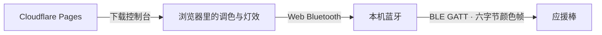

# 开发 SDK

[English](../SDK.md)
这是本项目独立编写的**主机侧 JavaScript SDK**，在浏览器中通过 Web Bluetooth 控制自己的棒子。不是芯片厂商的固件 SDK，不包含厂家代码、固件、反编译输出或串口工具。原厂 SDK 获取与逆向环境重建见 [逆向说明](../../re/README.zh-CN.md)。

## 开始使用

从仓库根目录启动静态服务 `python3 -m http.server 8765`，用支持 Web Bluetooth 的浏览器打开 `http://localhost:8765/sdk/examples/color.html`。部署到 HTTPS 后也可使用；连接必须由点击等用户操作触发，用户在系统选择框里自行选择设备。网页 SDK 不需要安装依赖。

```js
import { LightstickClient, colorFrame } from './web/sdk.js';
const stick = new LightstickClient({
  onState(state, detail) { console.log(state, detail); },
  onNotification(bytes) { console.log('设备回包', bytes); }
});
// 在按钮点击处理函数中执行，并捕获异常：
await stick.connect();
await stick.setColor([255, 0, 0]); // 参数是 RGB，SDK 转为线上的 GRB
await stick.setColor([0, 0, 0]);   // 熄灯
stick.disconnect();              // 断开不等于熄灯；已实测颜色会保持
console.log(colorFrame([12, 34, 56])); // 01 00 22 0c 38 99
```

Node 可导入 `sdk/index.mjs` 使用纯字节函数；Node 默认没有浏览器蓝牙 API。运行 `node --test tests/sdk.test.mjs` 执行模拟传输测试，测试不会连接真实设备。

## 浏览器兼容性

网页按安全上下文与 `navigator.bluetooth.requestDevice` 是否存在判断连接能力，不按设备型号拒绝访问。Windows、macOS、ChromeOS 和 Android 上的 Chrome 提供所需接口；Windows 与 macOS 上的 Edge 也支持控制器所需接口。Linux Chrome 的支持仍属试验性质，不能假定默认可用。iPhone / iPad 的常规 Safari、Chrome 未提供原生 Web Bluetooth；HTTPS、添加到主屏幕或把网站改成 PWA 都不能自行补上系统没有开放的蓝牙接口。

缺少接口时保留屏幕预览，连接按钮变为「怎么连接」，打开连接说明弹窗并停在访问者设备对应的分页。iPhone / iPad 分页给出国区 App Store 可下载的两条免费路线：Bluefy 浏览器与 beacio Safari 扩展，二者都是第三方桥接，不是浏览器原生支持；微信 / QQ 分页提示换到浏览器打开。没有改动蓝牙协议来绕过平台权限。

iOS 桥接会把 UUID 交给系统蓝牙，因此 SDK 导出的 `SERVICE`、`NOTIFY`、`WRITE` 是完整 128 位字符串，不是 16 位数字；缺少 `writeValueWithResponse()` 或 `writeValueWithoutResponse()` 时退回旧的 `writeValue()`。

依据：[Chrome 官方蓝牙说明](https://support.google.com/chrome/answer/6362090?hl=zh-Hans)、[Web Bluetooth 实现状态](https://github.com/whatwg/bluetooth/blob/main/implementation-status.md)。

### 从网页到灯棒



用户点击连接并选择设备后，SDK 连接服务、订阅通知、完成口令回显，再持续写入颜色帧。颜色指令不经过 Cloudflare；加载完页面后，网站网络延迟不会叠加到每次调色上。

手机能连接蓝牙耳机，并不代表网页也能控制 BLE 设备。前者由系统提供功能，后者需要浏览器向 JavaScript 开放 Web Bluetooth。iPhone 的当前限制在这一接口层，修改颜色协议、网页混色算法或 HTTPS 配置都不能补齐它。实现状态文档提到的 Safari 扩展通过原生进程桥接 CoreBluetooth，仍需要用户安装扩展，不属于 Safari 原生支持，也不符合本站免安装的要求。

若将来增加免安装的 iPhone 遥控，需要另一台附近、已支持网页蓝牙的设备承担连接，再通过网络接收 iPhone 指令。这是需要另行实现与验证的中继功能，当前版本没有提供。

## 接口与语义

| 接口 | 说明 |
|---|---|
| `frame(body)` | 纯函数，追加负和校验；不发送任何内容。输入必须为非空、0–255 的整数序列。 |
| `colorFrame([r,g,b])` | 纯函数，返回 `01 00 G R B checksum` 的 `Uint8Array`。严格校验三个颜色值。 |
| `validChecksum(bytes)` | 检查非空字节序列总和 mod 256 是否为 0；不是语义校验或身份验证。 |
| `new LightstickClient(options)` | 可选 `onState`、`onNotification` 和 `onWrite(bytes, elapsedMs)` 回调。回调应保持简短，不抛异常。 |
| `connect()` | 弹设备选择器、连接 FA00、订阅 FA01、向 FA02 写口令、在 4000 ms 内收到完全一致的口令回显，再等待 1200 ms 蓝灯动画；返回设备。并发连接调用会拒绝。 |
| `setColor([r,g,b])` | 返回 Promise；真正完成浏览器写入返回 `true`；被更新颜色替换的待发帧返回 `false`。断开或写入失败则拒绝。 |
| `nativeEffectFrame(kind, options)` | 纯函数，严格生成 `breathe`、`fade`、`blink`、`rgb-step`、`rgb-breathe`、`palette-cycle`、`rgb-burst` 帧。参数见下。 |
| `continuousColorFrame(rgb)` | 非中性色 / 全零用 `0e`；等值非零白色保留 `01`，防止意外满亮白光。 |
| `setNativeEffect(kind, options)` | 启动内置效果；等待匹配 FA01 回复及写入完成才返回 true；超时断开。 |
| `stopNativeEffect()` | 发送 `0d` 零色并等待匹配回复；停止效果并熄灯。 |
| `setContinuousColor(rgb)` | 连续直出颜色；调用前先 `await stopNativeEffect()` 建立直接输出模式。 |
| `disconnect()` | 取消尚未发送的颜色、移除监听、关闭 GATT。连接中的异步步骤也会检查取消状态。 |
| `ready`, `state`, `device` | 连接就绪布尔值、阶段字符串、当前设备（未连接时为 null）。 |

状态为 `selecting → connecting → authenticating → ready`；失败进入 `error`，断开进入 `disconnected`。`ready` 表示口令写操作完成、FA01 完整回显与口令逐字节一致，且经过 1200 ms 动画等待；缺少或错误回显会超时并断开。回显是设备协议握手，不是加密身份认证；`setColor` 的成功表示浏览器完成写操作，不证明灯光真实呈现。FA01 回包单独传给调用者，不能用 GATT 写耗时声称测得完整声光延迟。

发送器始终只有一个写操作在途，待发区只有最新一帧，避免动画积压。优先用无响应写，不支持时用有响应写。默认目标上限为 **60 次写入 / 秒**，`minGapMs` 为相邻写入开始之间的最小间隔（默认 `1000 / 60` 毫秒）；当前写入耗时计入此间隔，只等待剩余时间。传输本身比一帧慢时立即处理最新待发颜色，不额外叠加固定延迟，也不并发补发过期帧。实际速度仍受浏览器调度、蓝牙链路与设备处理能力限制。

网页在输出数值变化时才发帧，常亮、呼吸极值附近或低亮度时的次数可能低于上限。网页的 `FrameSender` 现在独立于屏幕刷新采样，并可通过 `?rate=90` / `?rate=120` 试验更高发送率；该实例设置 `minGapMs: 0`，由外层统一限速，公开 SDK 默认不变。具体时序和固件约 10 ms 延后处理的边界见 [高发送率试验](OUTPUT-TIMING.md)。

连接详情统计实际完成的控制写入和有效控制回包；不是光学刷新率或完整延迟。内置灯效稳定后通常为 0 次写入/秒。新命令经过静态追踪与模拟传输测试，仍需真实硬件回归；此前实测结论来自原控制台和命令行工具。

## 内置灯效 SDK（试验）

```js
// 以下放在用户点击连接后的异步处理函数内，捕获异常。
await stick.setNativeEffect('breathe', {rgb: [255, 32, 32]});
// 内部计时器持续呼吸，不要循环重发启动命令。
await stick.setColor([255, 16, 16]); // 更新基础色，保留呼吸阶段
await stick.stopNativeEffect();     // 明确退出并熄灯
await stick.setContinuousColor([80, 0, 0]); // 此后可连续发送新颜色
```

`breathe` 接收原始 `rgb`；`blink` 接收 `rgb` 和 `intervalMs`；`rgb-step` 仅接收 `intervalMs`；`fade` / `rgb-breathe` / `palette-cycle` / `rgb-burst` 不接收可调参数。`palette-cycle` 为 15 色轮播（`08 00 f8`），`rgb-burst` 为三色连闪（`07 00 f9`）；使用连闪前由应用征得用户开启闪光。毫秒间隔为整数 1–65534。SDK 不自动应用网页观感混色。最小交互示例见 [native.html](../../sdk/examples/native.html)。

启动与退出默认等待 1500 ms 匹配回复；可用 `replyTimeoutMs` 配置。所有调用仍共用一个在途写入和一个最新待发项；被后续调用覆盖的待发命令返回 false。开发者应串行 await 模式切换，检查返回值，然后才发送颜色；网页由 `DevicePlayback` 统一处理。回包可能早于浏览器写操作完成，SDK 会同时等待两者。

`01` 在 `02` / `04` 中只改基础色，不能当作退出命令；`03` 启动渐变，也不是复位。内置呼吸速度固定，实体按键呼吸另走内部模式 7，不能承诺两者完全一致。完整证据与白光特例见 [内置能力](NATIVE-EFFECTS.md)。

## 已知固件行为与证据等级

| 项目 | 已知含义 | 证据/边界 |
|---|---|---|
| `FA00 / FA01 / FA02` | 控制服务 / 读与通知 / 写入口 | 原工具已有设备实测记录。 |
| `JFKJ-20250421` | FA02 明文握手口令；停止约 8 秒断开计时器 | 固件逆向和原工具实测；不是用户账号密钥。 |
| `0x01` | 六字节设色帧 `01 xx G R B checksum`，xx 当前取 0 | GRB、红绿及熄灯由原工具实测。 |
| `R=G=B≠0` | 固件改用白光通道 | 既有逆向与白平衡测试记录；等值 RGB 不应当作 RGB 三通道独立混色。 |
| `0xa1` 回包首字节 | 灯效模式 2/4 的设色回包可能以此开头 | 既有记录；不是另一个公开发色命令。 |
| `0x02–0x08` | 已接入的内置灯效入口 | 静态布局与 SDK 模拟验证；`02` 主观顺滑度获用户实物确认，其余未逐项验收。 |
| `0x09–0x0c` | 组合 / 七色轮播 / 白光及红蓝图案 | 未开放设备调用封装。 |
| `0x0d` / `0x0e` | 强制停止后直出 / 连续设色 | 已追踪；等值非零 RGB 在这两个分支会开满 W。 |

## 固件函数地图（特定备份，不是通用 ABI）

以下名称是本项目按观察行为起的描述性名称；地址来自既有逆向笔记，仅对那份固件布局有意义。它们不是可直接从 JavaScript 调用的公开函数，也没有足够证据提供 C 函数原型。

| 地址 | 描述性名称 | 行为与继续研究的入口 |
|---|---|---|
| `0x1fff4290` | FA02 写回调 | 将输入拷到 `0x1fffc343`，约 10 ms 后处理；追踪长度校验。 |
| `0x1fff6774` | GATT 命令分发 | 比对口令、检查负和校验、按首字节分发；继续标注 `02–0c` 分支参数。 |
| `0x1fff2fd4` | 原始射频任务事件处理 | OSAL 任务 10；独立于普通 GATT 控制。 |
| `0x1fff73c0` | 原始射频收包 | 过滤 AdvA，把载荷交给解析器。 |
| `0x1fff6b14` | 现场广播载荷解析 | XOR 解码、求和与分组/类型分发；仅逆向，未实测。 |
| `0x1fff7c60` | 灯效任务 | OSAL 任务 11；后续可追踪颜色如何作用于通道。 |
| `0x1fffc1cc` | 射频配置结构（数据，不是函数） | `+0x20` 格式/白化/CRC，`+0x24` CRC 初值，`+0x28` Access Address，`+0x40` 频率。 |

复现方法见 [Ghidra 重建](../../re/README.zh-CN.md)。贡献新发现时记录硬件版本、自己的固件哈希、函数地址、输入/响应原始字节、可复现步骤与实测现象；分别标注推断和实测，不能把反编译器猜测的函数签名当成事实。

现场广播字节生成保留在 `scripts/venue_packet.py`，与 SDK 的 GRB GATT 帧不是同一种协议；广播是 RGB。该脚本不发射。不要在演出/活动现场发包；类型 6 会把他人分组写入 flash。SDK 只封装已追踪布局的 GATT 命令，不提供广播发射、任意命令设备调用或 OTA 入口，也不向 `5833ff01` 写入。

## 与网页色轮的关系

SDK `setColor` 接收原始RGB驱动值。网页先通过 `web/color.js` 的 `renderColor` 做观感混色，再调用SDK；请勿对已转换值重复应用映射。网页唯一混色标准、黄色微调和样机验收范围见 [混色说明](COLOR-MIXING.md)。

网页手动亮度与呼吸由 `web/dimming.js` 生成整体亮度系数：滑块平滑后经过温和二次曲线，呼吸单独生成连续包络，再交给 `renderColor` 最后取整。SDK 不自动应用这些曲线，开发者传入 `[128,0,0]` 仍发送原始 128。详细换算和 8 位暗部限制见 [调光说明](DIMMING.md)。
