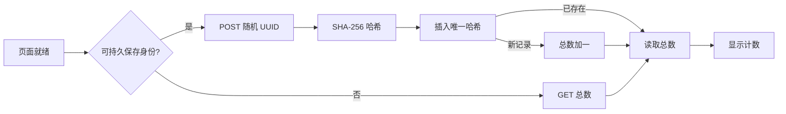

# 到访计数

[文档](README.md) · [English](../VISITORS.md)

页头显示启用计数后成功登记的浏览器身份数，从零开始。它不统计独立人数、蓝牙连接数或灯棒数量。窄屏下，计数位于 Logo 右侧。

## 数据流程



浏览器用 `crypto.randomUUID()` 创建 UUID v4，保存在 `localStorage` 的 `wuwa.visitor.v1`。后续访问同一来源时复用该 ID。

服务端将 ID 转为小写，计算 SHA-256，只保存哈希。主键防止重复登记。`AFTER INSERT` 触发器更新 `visitor_totals` 中的唯一一行。插入和查询在一个 D1 `batch()` 中执行。

计数数据库不保存原始 UUID、IP、User-Agent、时间、蓝牙数据或操作记录。请求不携带 Cookie 和 Referrer。Cloudflare 仍处理普通 HTTP 流量数据。

## 计数边界

- 刷新和操作控件复用已保存的身份。
- 支持 Web Locks 时，首次创建身份会在标签页之间串行执行。不支持时，首次并发打开可能生成多个 ID。
- 每个来源有独立存储。同一浏览器访问两个正式域名可能计两次。
- 更换浏览器、配置、设备、清除存储或新开私密会话，可能再次计数。
- 无法持久保存身份时，只读取总数，不登记临时 ID。
- 脚本可以提交新的 UUID。来源和输入检查不是完整防刷系统。

此数值仅作社区到访指标，不应称为精确人数。

## 页面接入

保留这两个元素 ID：

```html
<div id="visitorCount" class="visitor-count" hidden>
  <span id="visitorTotal" class="ms-readout"></span>
  <span class="web-small">位共鸣者到访</span>
</div>
```

只加载一次 [visitors.js](../../web/visitors.js)。脚本没有导出接口，构建时内嵌到首页。DOM 就绪后请求一次，不轮询。失败或六秒超时后隐藏计数。蓝牙初始化不等待计数请求。

只有配置的两个正式 HTTPS 来源会发送请求。Localhost、分支预览和临时部署域名不生成身份，也不请求计数。API 同样拒绝这些来源。

## API

[functions/api/visitors.js](../../functions/api/visitors.js) 提供 `/api/visitors`，需要名为 `VISITORS_DB` 的 D1 绑定。

| 请求 | 结果 |
|---|---|
| `GET /api/visitors` | 读取总数：`200 {"total":0}`。 |
| `POST /api/visitors`，JSON 为 `{"id":"UUID-v4"}` | 首次登记后返回总数。重复 ID 不增加计数。 |

POST 要求匹配的 `Origin`、`application/json`，以及唯一的 UUID v4 字段。请求体上限 256 字节，声明长度和实际数据流均检查。

| 状态码 | 含义 |
|---|---|
| `400` | 输入无效。 |
| `403` | POST 来源不匹配。 |
| `404` | 请求 URL 不在正式来源名单中。 |
| `405` | 方法不支持。 |
| `413` | 请求体过大。 |
| `415` | 内容类型错误。 |
| `503` | 数据库未绑定或不可用。 |

响应禁用浏览器及 CDN 缓存，不返回数据库诊断，也不开放跨来源读取。

## 建立自己的计数器

1. 在自己的账号中建立独立 D1 数据库。
2. 应用 [0001_visitors.sql](../../migrations/0001_visitors.sql)。
3. 只在生产环境绑定 `VISITORS_DB`。测试使用独立数据库。
4. 在部署配置中设置自己的数据库 ID。ID 是资源标识，不是凭据。
5. 更新浏览器脚本和 API 的来源名单。
6. 从仓库根目录部署，使 Wrangler 编译 `functions/`。
7. 确认 `dist/_routes.json` 只让 `/api/visitors` 进入函数。
8. 在测试库验证重复 ID 和数据库失效。生产库只用 GET 检查总数，不填入测试 ID。

迁移命令：

```sh
npx wrangler@4.152.0 d1 migrations apply YOUR_DATABASE --env production --remote
```

执行前确认账号、环境和数据库。参见 [Pages D1 绑定](https://developers.cloudflare.com/pages/functions/bindings/#d1-databases)、[D1 迁移](https://developers.cloudflare.com/d1/reference/migrations/)和 [Functions 路由](https://developers.cloudflare.com/pages/functions/routing/#functions-invocation-routes)。

## 验证

用 Node.js 24 运行 `node --test tests/visitors.test.mjs`。测试通过 `node:sqlite` 执行真实迁移与触发器，覆盖重复身份、并发、回滚、请求体限制、来源检查、缺失绑定、存储失败、Web Locks、超时及失败隐藏。

本地 SQL 测试不代表生产 D1 绑定或线上浏览器已通过验证。D1 批处理行为见 [D1 API](https://developers.cloudflare.com/d1/worker-api/d1-database/#batch)。
